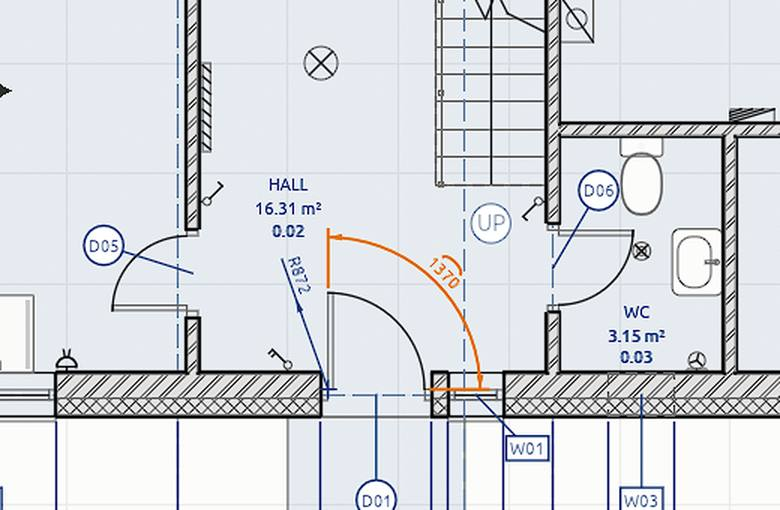

# Dimensions

Dimensions measure the model. Their points stick to what they measure (wall corners, door and window edges, levels, grids, columns, masses), so they update when it moves.

## Temporary dimensions

Select one wall, grid line, door, window or column in a plan. Blue dimensions show the distance to its nearest neighbours: the parallel walls and grid lines beside a wall or grid line, the nearest grid lines or walls to a column, and the wall's ends or the next opening beside a door or window.

- **Click a value and type a new one**, then `Enter`. The element moves to make it true. A wall takes its doors and windows and the walls joined to it along; a grid line takes the walls and columns standing on it. `Tab` moves on to the next value, `Backspace` takes a character back and `Esc` stops.
- **Click the padlock** beside a value to keep it as a dimension that holds the spacing. Moving either end then moves the other by as much. Click a closed padlock to let it go; the dimension stays. A dimension that holds its spacing shows a faint padlock by its value, strong while it or one of its ends is selected; it is on screen only, so sheets print a plain dimension.

The typing works like typing a length while drawing a wall. Nothing is added to the drawing unless you lock a value.

A selected wall always shows its own length beside it, to type as well: the end nearer the middle of the view moves, and the walls joined there follow. Gaps to neighbours more than 10 m away are left out, and a value never sits on one of the element's grips.

### Levels in sections

Select a level in a section or elevation: it shows its height above the level below and below the level above. Click one and type to move the level, with everything on it. The padlock holds a level spacing. A placed dimension whose two ends are on levels takes a typed value too: the level at the end nearer your click moves, the other stays.

Temporary dimensions can be muted with the toggle in a plan's header; off, none show and none can be clicked.

## Linear dimensions

1. Pick the **Dimension** tool.
2. Click two points to measure. They snap to corners and edges.
3. Click where the dimension line goes.

In the tool options choose the direction:

- **Auto**: from where you drag the line. Beside both points it measures vertically, above or below them horizontally, otherwise along the two points. Hold `Shift` to keep the one shown.
- **Aligned**: the true distance between the points.
- **Horizontal** or **Vertical**: the distance across or up the drawing.

A placed dimension's *Measures* in *Properties* changes it later. Drag a selected dimension to move its line. **Move** takes dimensions too: free ends go with what is moved, and a line between two things slides square to itself.

### Chains and rows

- **Continuous** (tool options): after the first dimension, each click adds the next on the same line, until `Esc` or a right-click.
- **Even spacing** and **Spacing**: dimension lines land on steps of the spacing (millimetres on paper) from what they measure, so rows stay even. Typing a spacing turns it on. Either way, a new dimension's line snaps onto a parallel dimension's line nearby.
- The Dimension tool snaps from its first point, as the drawing tools do: the second point locks on the first's horizontal and vertical.

With nothing selected, `D` picks the Dimension tool; with a selection, `D` shows or hides its live dimensions.

## Angles

Pick the **Angle** tool. Click two lines (wall faces, edges), then where the arc goes. Or click the corner and one point on each arm. The side you place the arc on picks the inside or outside angle.

## Radius and diameter

Pick **Radius** or **Diameter**. Click an arc or circle (a door swing, a sketch arc), or three points on one, then where the dimension goes.

## Arc length

Pick **Arc length**. Click an arc, or its start, a point on it and its end, then where the dimension goes.

## How they look

Pick a **Style** in the tool options for new dimensions; change a placed one's style or *Own colour* in *Properties*. See [Annotation styles](styles).

How the numbers read (unit, decimals, zeros) comes from the style pack's **number format** for dimensions; one dimension can set its own in *Properties*. See [Units and number formats](units#number-formats).

## Breaking around tags

A style with **Break dimension lines at tags** on leaves a gap in its dimension lines wherever a tag's bubble or a note's text sits across them, so a chain of dimensions stays readable past the door tags on it. Dimensions in other styles run straight through.

To write the height of a point rather than a distance, use a [spot level](spot-levels).

Dimensions work in plans, sections and elevations, show on sheets and print in PDF and SVG.
