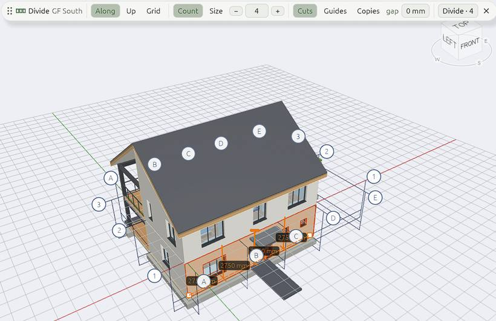

# Divide

**Divide** splits an element into parts: a wall into panels or courses, a beam into bays, a shelf unit into shelves. It can cut the element, put guides at the divisions, or place a copy of something in each part.

## Opening Divide

1. Select a wall, a beam, a guide, or a part drawn from a plan outline.
2. Right-click it and pick **Divide…**, use *Edit › Divide…*, or click **Into even parts…** in the *Make from it* section of *Properties*.

A slim **Divide** bar opens at the top of the views, and every view shows where the divisions fall while it is open: ticks in plans, lines in sections and 3D, and each part's size on a chip. Drag the bar by its grip to move it; a double-click puts it back.

## The Divide bar

| Setting | What it does |
| --- | --- |
| **Along**, **Up**, **Grid** | Along its length, up its height (courses, bands, shelves), or both ways at once: panels |
| **Count** or **Size** | So many parts, or parts of a size. Change the number with `−` and `+`, the mouse wheel, by dragging it or by typing |
| **Rest** (with *Size*) | Where what is left over goes: **Rest at both ends** (full parts centred, a short one at each end), **at the start**, **at the end**, or **Spread evenly** (as many equal parts as are nearest the size) |
| **Cuts**, **Guides**, **Copies** | What it makes at the divisions (below) |
| **Gap** (with *Cuts*) | Left between the parts: a joint |

Press `Enter`, or click **Divide · n**, to divide: the whole division is one undo step. `Esc` leaves the bar without changing anything.

Divided parts remember how they were divided for the rest of the session, so Divide on one of them opens as it was left.

## What it makes

| Make | Gives |
| --- | --- |
| **Cuts** | The element cut into parts: a wall into walls side by side or stacked (a base course, bands), a part into bays or shelves. With *Grid*, panels both ways |
| **Guides** | A guide across it at each division, to snap to, shown dashed while you set it up. With *Grid*, guides both ways |
| **Copies** | What you `Shift`+click, one in each part |

For **Copies**, open Divide on the element first, then `Shift`+click what goes in each part. A sketch has to be extruded first, or draw a [guide](guides) along it.

> **Tip:** **Divisions** in the [snaps](snaps) list snaps to the even parts of any edge (its thirds, quarters, fifths…) without changing anything.

To cut an element along a line of your own instead, use [Split](edit#split).
