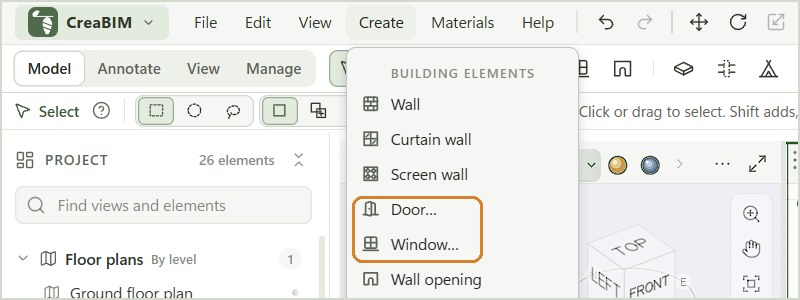
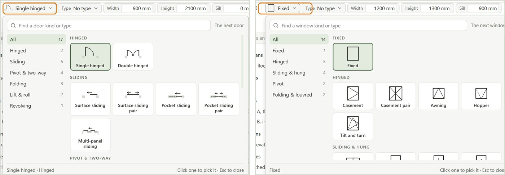
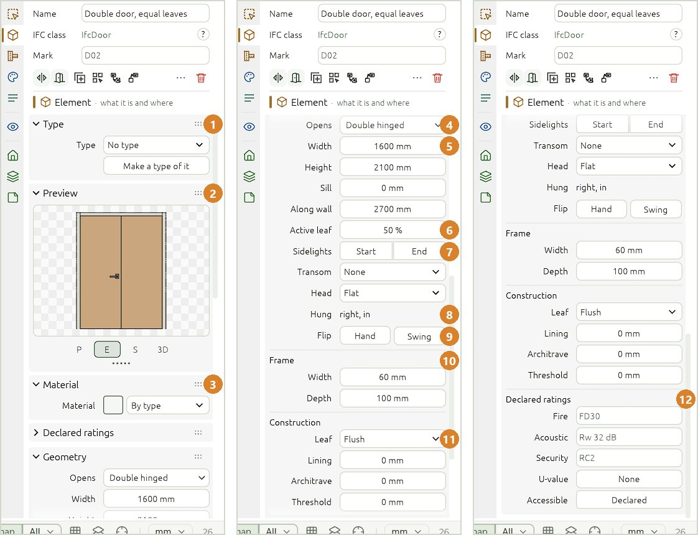
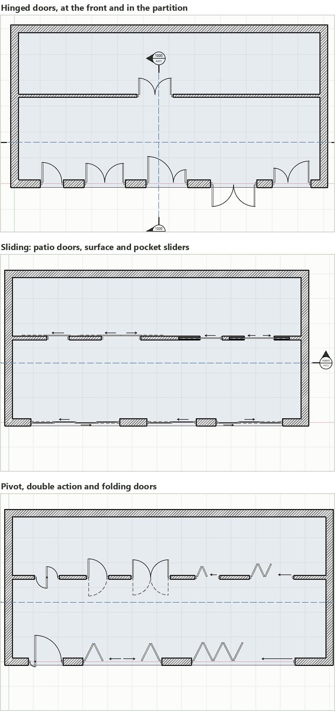
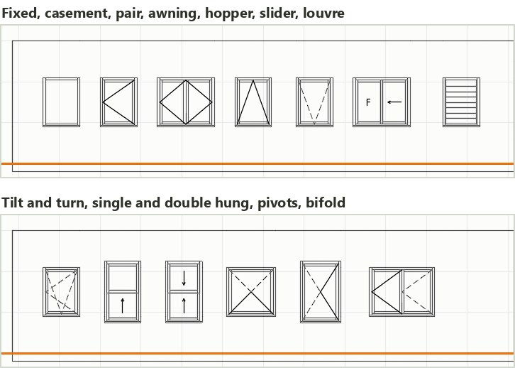
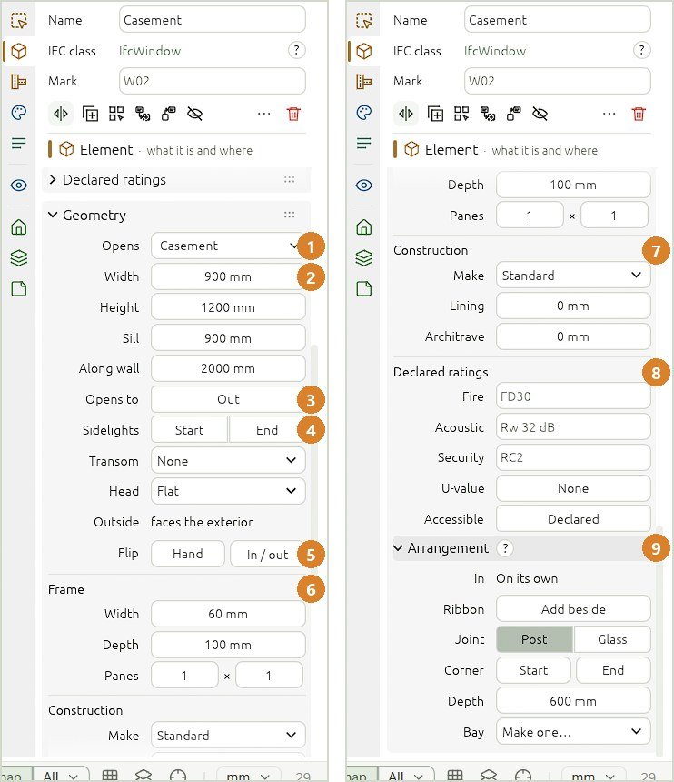

# Doors and windows

Doors and windows are hosted by a wall: they cut their opening in it and move with it.

## Choosing what kind

Every way a door or window opens is in one **picker**, as pictures: doors drawn in plan, windows in elevation, by family (hinged, sliding, pivot and two-way, folding, lift and roll, revolving; for windows: fixed, hinged, sliding and hung, pivot, folding and louvred). Your own door and window **types** come first.

- **Before placing**: with the Door or Window tool on, the first button in the bar shows the kind you'll place. Click it and pick. *Create* › **Door…** and **Window…** open the picker straight away.
- **After placing**: select a door or window. **Opens**, the first row of *Geometry* in *Properties*, names its kind; click it to open the picker for everything selected.
- **Types**: a kind with its sizes, frame, leaf and trim, named and reused. Make one with **Make a type of it** under *Type*; the browser's **Opening types** group lists them with how many are placed.

## Placing them

Pick the **Door** or **Window** tool and click on a wall, in a plan, a section, an elevation or 3D. Pick a **Type** in the tool options to place a door or window of that type, or type its **Width**, **Height** and **Sill** there before you click (typing a size drops the type, as a wall's thickness does). The same settings are in the **Next element** tab of *Properties*.

Before you click, a **ghost** shows exactly what lands: the frame and the cut through the whole wall, in plans and in 3D. Off a wall, it says *Move onto a wall*. A door or window stays inside its wall's clear length: it stops at a wall joined at the corner instead of cutting into it.

## Changing them

Select one, then:

- set its *Width*, *Height* and *Sill* (the height of its bottom edge above the wall's base) in *Properties*;
- drag it along its wall to move it (it stays in the wall);
- drag its jamb handles to widen it, or its head and sill handles to change its height, in a plan or in 3D;
- pick a material, and its **Frame**: *Width*, *Depth*, and for windows *Panes* across × up.

## A door's Properties

1. **Type**: the door's type, or *Make a type of it*.
2. **Preview**: the door on its own, in plan (*P*), elevation (*E*), section (*S*) or *3D*.
3. **Material**.
4. **Opens**: its kind; click to open the picker.
5. **Width**, **Height**, **Sill** and **Along wall**.
6. **Active leaf**: on a pair, the share of the clear width the leaf with the handle takes; 50 % makes equal leaves.
7. **Sidelights**, **Transom** and **Head** (below).
8. **Hung**: which jamb and which side, such as *right, in*.
9. **Flip** › *Hand* or *Swing* (below).
10. **Frame**: *Width* and *Depth*.
11. **Construction**: *Leaf*, *Lining*, *Architrave* and *Threshold* (below).
12. **Declared ratings** (below).

## Single and double doors

*Opens* in *Properties* sets how a door opens:

- **Single hinged:** one leaf.
- **Double hinged:** a pair of leaves meeting in the middle. Both open to the same side. The **active leaf** has the handle and is hung on the door's hand side. The other leaf stays bolted until it is needed.

For a pair, *Active leaf* sets the active leaf's share of the clear width. At 50 % the leaves are equal. At 67 % a 1600 door has leaves of about 1000 and 500. Flipping the hand moves the active leaf to the other jamb.

A door type has the same *Opens* setting, so every door of that type opens the same way.

Each drawing shows the pair:

- **Plan:** both leaves are drawn open with their swings.
- **Elevation and section:** each leaf has an opening triangle. The apex is on its hinge side. The triangle is solid where the leaf opens towards you and dashed where it opens away.
- **Schedule:** the *Operation* column reads, for example, *Double hinged, 981 + 489*, with the active leaf first, in millimetres.
- **IFC:** the door's operation type is *DOUBLE_DOOR_SINGLE_SWING*, and an imported door with that type comes back as a pair.

## Sliding doors

*Opens* also has five sliding doors:

- **Surface sliding:** a leaf on a track on the wall's face, sliding along the wall.
- **Surface sliding pair:** two leaves on one track, parting from the middle.
- **Pocket sliding:** a leaf sliding into a cavity in the wall. The wall needs to be about 110 mm thick or more.
- **Pocket sliding pair:** a leaf into a cavity on each side.
- **Multi-panel sliding:** 2 to 4 glazed panels on two tracks. Set **Panels**, then click each panel's **F** (fixed) or **S** (sliding) in the **Fixed** row.

For a sliding door, *Flip › Hand* (`Shift+Space`) makes it slide the other way, and *Flip › Swing* (`Space`) puts it on the other face of the wall.

Each drawing shows it:

- **Plan:** the leaves closed, where they slide to dashed, and an arrow. A pocket door's wall shows as two skins with the cavity between.
- **Elevation and section:** an arrow on each sliding leaf, where it slides to outlined dashed, and an F on each fixed panel.
- **Schedule:** for example *Multi-panel sliding, F S S F*, with the panels read from inside.
- **IFC:** *SLIDING_TO_LEFT*, *SLIDING_TO_RIGHT* or *DOUBLE_DOOR_SLIDING*.

A pocket door that cannot work where it stands says why under its rows in *Properties*: the wall is too thin (with the thickness it needs), the wall is curved, the wall ends before the pocket does, or another door or window is in the way. Each leaf of a pocket pair is checked on its own. Nothing is moved for it.

## Pivot, double action and folding doors

*Opens* also has these doors:

- **Offset pivot:** a leaf turning on a pivot in the floor and head, set in from the hinge side by a sixth of its width. Good for a tall, wide front door.
- **Centre pivot:** a leaf turning on a pivot at its middle.
- **Double action:** a leaf that swings both ways, with push plates instead of a handle. **Double action pair** is two of them meeting in the middle, with *Active leaf* as for a double door.
- **Bifold:** two panels folding against the hinge jamb, the handle on the leading panel. **Bifold pair** folds two panels to each jamb.
- **Folding:** 3 to 6 equal panels folding and stacking against the hinge jamb. Set how many with **Panels**.

A pivot or double action leaf sits in the middle of the frame's depth. *Flip › Hand* moves the hinge or pivot (or the stack) to the other jamb, and *Flip › Swing* opens it to the other side.

Each drawing shows it:

- **Plan:** a pivot leaf turned square about its pivot, marked with a cross, and both arcs it sweeps. A double action leaf open one way with its arc, and the swing the other way dashed. A folding door's panels zigzag out from the jamb they stack against, with an arrow towards it.
- **Elevation and section:** a pivot leaf has two triangles pointing at the pivot, one solid and one dashed, as its two parts turn opposite ways. A double action leaf's triangle is solid from either side. A folding door has a triangle on each panel, alternately solid and dashed, as they fold alternately.
- **Schedule:** *Offset pivot*, *Double action pair, 734 + 734*, *Folding, 5 panels*, and so on; *Hand* reads *Right, both ways* or *Folds left, in*.
- **IFC:** *DOUBLE_SWING_LEFT* or *_RIGHT*, *DOUBLE_DOOR_DOUBLE_SWING*, *FOLDING_TO_LEFT* or *_RIGHT* and *DOUBLE_DOOR_FOLDING*. IFC has no pivot door, so a pivot door goes out as *USERDEFINED* (*OFFSET_PIVOT* or *CENTRE_PIVOT*). A folding door's panels go out in the *CreaBIM_Opening* property set, so it comes back with as many panels.

## Sectional, roller and revolving doors

*Opens* also has these larger doors:

- **Sectional overhead:** a garage door of panels about half a metre high, rising on tracks to lie under the ceiling, with a pull handle on the bottom panel.
- **Roller shutter:** 75 mm slats in guides on the jambs, rolling up into a box over the opening.
- **Revolving:** four glazed wings round a post, turning in a drum as wide as the opening.

*Flip › Swing* puts a sectional door, or a roller shutter's box, on the other side of the wall.

Each drawing shows it:

- **Plan:** a sectional door in its frame, with the panels lying open drawn dashed into the room as far as the door is high. A roller shutter's curtain, with its box dashed over it. A revolving door's drum walls at each side, its post and its four wings.
- **3D and section:** the panels or slats closed, the roller box over the head, the revolving door's post and wings.
- **Schedule:** *Sectional overhead*, *Roller shutter* or *Revolving*; *Hand* reads *Up, in* for a door that rises.
- **IFC:** a roller shutter goes out as *ROLLINGUP* and a revolving door as *REVOLVING*. IFC has no sectional door, so it goes out as *USERDEFINED* (*SECTIONAL_OVERHEAD*). A *LIFTING* door from another program comes in as a sectional door.

## Roof windows

A roof window is set in a roof's slope instead of a wall. To add one, select the roof and press **Add** on its **Roof windows** row. It goes in the middle of the roof's largest slope, 780 × 1400, turning on centre pivots. Move it with **M**, or set **Centre X** and **Centre Y**, which say where its middle is in plan. Its **Width** runs across the slope and its **Height** up it.

*Opens* has three choices:

- **Fixed:** glass that does not open.
- **Top hung:** hinged at its head, opening out at the bottom.
- **Centre pivot:** turning on pivots at the middle of its sides.

*Roof* and *Pitch* show the roof it is set in and that roof's slope there.

The roof is cut square to its slope for the window, and a lining runs round the hole from the frame down to the roof's underside. The frame stands 20 mm proud of the roof.

Each drawing shows it:

- **Roof plan:** the frame and the glass inside it, as they fall in plan.
- **Elevation and section:** the window in the slope, with its marks as a window in a wall has: a triangle with its apex at the head for top hung, two triangles meeting at the axis for centre pivot.
- **Schedule:** *Roof window, fixed*, *Roof window, top hung* or *Roof window, centre pivot*. *Wall* names the roof, and *Sill* reads *-*.
- **IFC:** an *IfcWindow* of type *SKYLIGHT*, filling an opening that voids the roof. Where it sits on the roof goes in the *CreaBIM_Opening* property set, so it comes back in its roof.

## Windows

*Opens* in a window's *Properties* sets how it opens:

- **Fixed:** glass that does not open.
- **Casement:** a sash hinged at one side.
- **Casement pair:** two sashes meeting in the middle.
- **Awning:** a sash hinged at the top, opening out at the bottom.
- **Hopper:** a sash hinged at the bottom, opening in at the top.
- **Horizontal sliding:** a fixed light and a sash sliding past it.
- **Louvred:** glass blades that turn together.
- **Tilt and turn:** a sash that opens into the room on side hinges, or tilts in at the top for air, by its handle.
- **Single hung:** two sashes one above the other; the lower one slides up past the fixed upper one.
- **Double hung:** both sashes slide, the lower one up and the upper one down.
- **Horizontal pivot:** a sash turning on pivots at the middle of its sides, the bottom swinging out and the top in.
- **Vertical pivot:** a sash turning on pivots at the middle of its head and sill.
- **Bifold:** two sashes folding against the window's start, like a servery hatch.
- **Guillotine:** one sash sliding straight up into the wall over it, like a servery hatch or a ticket window. Its elevation shows the arrow up and, dashed, where the sash goes.

New casements open out. To make them open in, set *Casements open* to *In* under *Manage › Project information › Doors and windows*. Each casement can still open the other way: the **Opens in** row has a button per casement, lit when it opens into the room.

A window is a grid of **cells** inside its frame: columns and rows, with mullions and transoms between them where you want them. Each cell is a fixed light or a sash that opens its own way. A window of several cells, such as a fixed sidelight and two casements under a fixed transom, reads *Custom grid* in *Opens*. *Panes* (across × up) adds glazing bars inside each cell; it doesn't split the window into cells.

Under *Construction*, *Make* sets how a window is made:
- *Standard:* as before.
- *French:* small panes between glazing bars, about 300 × 360 mm each until you set *Panes*.
- *Slim steel:* a thin black steel frame, sashes and bars round small panes, about 400 × 450 mm each. Choosing it slims the frame to 40 mm.

The window schedule gains a *Make* column once a window has one.

Each drawing shows it:

- **Plan:** an opening sash drawn in the frame, with its swing dashed (a casement) or an arrow (a slider).
- **Elevation and section:** an opening triangle on each sash. The apex is on the hinge side: at the top for an awning, at the bottom for a hopper, at the side for a casement. It is solid where the sash opens towards you and dashed where it opens away. A slider has an arrow, and its fixed light an F.
- **Schedule:** the *Operation* column names it, for example *Casement pair*, or for a grid the cells it has, such as *Casement ×2 + fixed ×4*.
- **IFC:** the window type's partitioning (*SINGLE_PANEL*, *DOUBLE_PANEL_VERTICAL*, and so on). A grid that IFC has no name for carries its cells in a *CreaBIM_Opening* property set, so it comes back as it went out.

The newer windows draw their own way. A tilt and turn sash has a casement's triangle and a hopper's together. Hung sashes have an arrow up on the lower sash, and down on the upper one when it slides. A pivot sash has two triangles meeting at its axis, one solid and one dashed, because its two halves turn opposite ways; in plan a vertical pivot shows the sash turned square, dashed, with its swing. A bifold window's sashes are drawn alternately solid and dashed, and in plan they zigzag out from their stack. The *Opens* button shows a short name when the full one would not fit, such as *Tilt-turn*, *Both hung* (double hung) or *Level pivot* (horizontal pivot).

To point the triangles at the handle side instead, as some offices draw them, set *Triangle apex* to *Handle* under *Manage › Project information › Doors and windows*. It changes every elevation and section in the project, doors too.

### A window's Properties

1. **Opens**: its kind; click to open the picker.
2. **Width**, **Height**, **Sill** and **Along wall**.
3. **Opens to**: which way the sash opens; click to change it.
4. **Sidelights**, **Transom** and **Head** (below). *Outside* says which face is the exterior.
5. **Flip** › *Hand* or *In / out*.
6. **Frame**: *Width*, *Depth* and *Panes* across × up.
7. **Construction**: *Make*, *Lining* and *Architrave*.
8. **Declared ratings** (below).
9. **Arrangement**: a ribbon of windows side by side (below).

## Sidelights and transoms

A door or window can have fixed lights round it, in the same frame:

- **Sidelights:** click *Start*, *End* or both. *Start* is the end nearer the wall's start. *Sidelight* sets their width.
- **Transom:** a light over the whole opening, *Fixed*, *Awning* (opening out) or *Hopper* (opening in). *Its height* sets how tall it is.

The door or window inside keeps working as before. *Opens*, *Active leaf*, the panels of a multi-panel slider and a casement's *Opens in* all change it alone, and the lights stay. *Flip › Hand* hangs a door on its other jamb but leaves its sidelight where it is. The lights face the outside of the building, whichever way the door opens.

Each drawing shows them: the door's swing or slide as before, glass in the lights, and an opening transom's triangle in elevation. The schedule's *Operation* reads, for example, *Double hinged, 967 + 480, with sidelight and transom*. In IFC the door keeps its own operation type, and the whole frame goes out in the *CreaBIM_Opening* property set, so it comes back as it went out.

## Arrangements

Windows can work together while each keeps its own frame. Select a window and open *Arrangement* in *Properties*:

- *Add beside* puts the same window frame to frame next to it, coupled in a **ribbon**. Press it again to make the ribbon longer. When the wall runs out before the corner, the next one goes before the first.
- *Corner*, *Start* or *End*, takes the window into the corner where another wall meets this one and puts the same window round it, in the other wall. Both face out of the same side of the building.
- *Joint* says how the two meet at the corner: a **post** between the two frames, or **glass** to glass with no post, the panes meeting at a sealed joint. Changing it changes both windows.
- *Bay*, *Make one…*, then *Box bay*, *Angled bay* or *Bow window*, makes a **bay window** of it, *Depth* out from the wall: the wall opens over the window's width and a run of short walls, the same as the wall, comes out round the bay with the same window in each side, meeting its neighbours at a post or glass to glass. *Box* has square sides, *Angled* sides at 45 degrees, *Bow* a curve of five facets. The floor runs out under the bay.
- *Group*, *Leave* leaves the window where it is, on its own.

A window round a corner stays on its corner when its wall grows or shrinks. Window schedules gain an *Arrangement* column ("Ribbon 1", "Corner 2, glass") once some window is in one, and the arrangement travels in IFC files.

## Arched and raked heads

*Head* sets the shape of the top of a door, window or hole:

- **Flat:** the usual square head.
- **Segmental:** a shallow arch, part of a circle. *Rise* sets how far it rises above its sides.
- **Round:** a semicircle, rising half the width. On an opening too low for one, it becomes as tall a segmental arch as fits.
- **Raked:** a sloping head, as under a stair or a roof. *Falls to* sets which end is lower, and *Fall* sets by how much.

The wall is cut to the shape, and the frame follows it. Glass under the head is shaped to the frame's inside. When you arch a door or a window that opens, and it has no transom, a fixed transom light is added under the arch, so its leaves and sashes stay square. A fixed window needs none: its glass fills the arch.

The schedule's *Operation* ends with the head, for example *Double hinged, 734 + 734, with transom, round-headed*. In IFC the opening is cut in its shape, and the frame and glass of the head are shaped too.

## Leaves, trim and ratings

Under *Construction* in *Properties*:

- **Leaf** (doors): *Flush*, *Panelled* (four sunk panels), *Glazed*, *Part glazed* (glass above a solid panel), *Louvred* (slats) or *Vision panel* (a narrow upright light), and three glass leaves:
  - *All glass:* frameless 12 mm toughened glass with a long pull handle on each face. Its *Fittings* row picks how it is held: *Patches* (type F, a patch fitting at each corner), *Bottom rail* (type BP, a rail along the bottom and a patch at the top on the hinge side) or *Rails* (type A/P, a rail along the top and the bottom). A pair has a pull handle on each leaf. Give it a slim *Frame width*, such as 30 mm, for a frameless look.
  - *French:* stiles and rails round small panes between glazing bars.
  - *Slim steel:* thin black steel stiles and rails round small panes. Its frame is black too, unless the door has a material.

  For *French* and *Slim steel*, *Panes* sets how many panes each leaf has across and up. Until you set them, the leaf has panes about 300 × 360 mm (French) or 400 × 450 mm (slim steel).

  Every leaf of the door is made the same way.
- **Lining:** a board on the reveal, from the frame to the room face of the wall.
- **Architrave:** its face width, round the opening on the room face.
- **Threshold** (doors): its height. The leaves stand clear of it.

0 leaves a piece out. The room side is the wall's inside: flip the wall to change it. 3D always shows the trim. Sections and elevations show it at 1:20 and larger only, so drawings at 1:50 and 1:100 stay clean.

Under *Declared ratings* you can record what is declared for the door or window: *Fire* (such as FD30), *Acoustic* (Rw 32 dB), *Security* (RC2), *U-value* and *Accessible*. They are information only: CreaBIM carries them as given and never checks them. The schedule gains a column for each one that any door or window has. In IFC they go in *Pset_DoorCommon* or *Pset_WindowCommon*, where other programs look for them.

## Flip, hand and swing

A door has a **hand** (which jamb the hinges are on) and a **swing** (which side it opens to). *Properties* reads, for example, *Hung right, in*.

- `Space`, or *Flip › Swing* in *Properties*, flips the swing.
- `Shift+Space`, or *Flip › Hand*, flips the hand. *Hung* reads the result, such as *left, in*.
- A window flips inside and outside with `Space`, or *Flip › In / out* in *Properties*.

## Tags and schedules

The **Tag** tool labels a door or window with its mark (D01, W01). *Tag all* (`Shift+T`), or *Tag openings* in the view's header, tags all of them in the view at once. A door or window schedule lists them all, and you can edit sizes in the table. See [Tags](tags) and [Schedules](schedules).

## Holes with nothing in them

For a bare hole in a wall, use the **Wall opening** tool. See [Holes, wall openings and shafts](holes).
