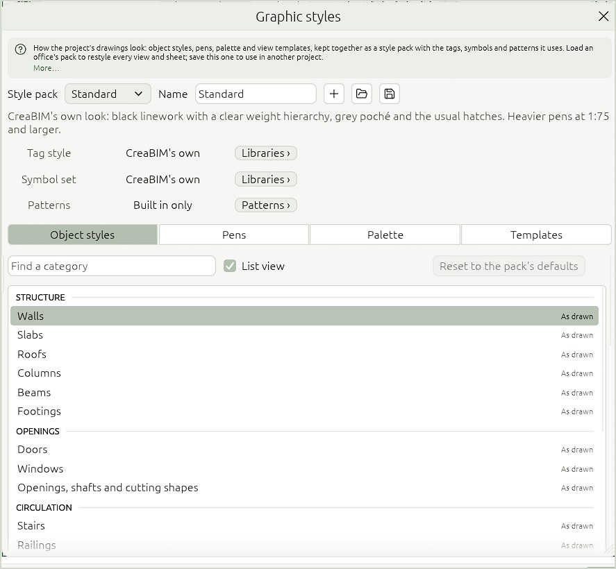
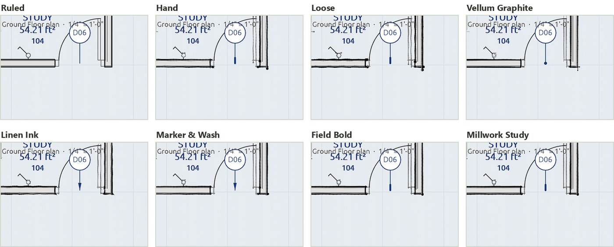
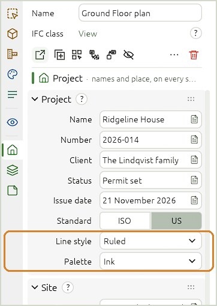
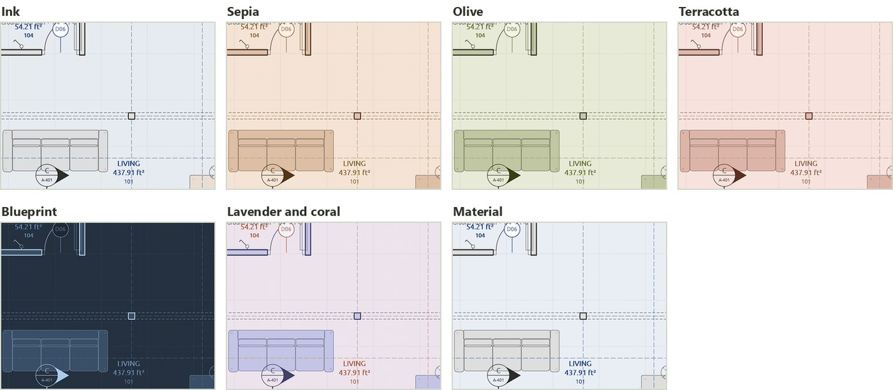

# Graphic styles

How every drawing looks is data in the project, not built into CreaBIM: pen widths for each scale, how each category of element draws (its **object style**), the palette, and **view templates**. All of it is kept together as a **style pack**, a `.json` file an office can keep its drawing standard in, with the tags, symbols and patterns it uses. Load another pack and every view and sheet is restyled.

The *Graphic styles* window has four pages: *Object styles*, *Pens*, *Palette* and *Templates*. Under the pack, one row each shows its **tag style**, **symbol set** and **patterns**, with a link to where they are picked and made: *Libraries › Tags*, *Libraries › Symbols* and the *Patterns* area.

## Style packs

Open *File › Graphic styles…*.

- The *Style pack* list shows the packs in the project. The one ticked is the default: the project draws with it.
The pack buttons sit beside the list: **+** adds a shipped pack, the folder loads one from a file, the disk saves this one.

- *Add a shipped pack*: CreaBIM comes with two, *Standard* (its usual look: black linework, grey poché, the usual hatches) and *Light linework* (fine pens, pale blue-grey poché, furniture in grey, sections fading with depth, sun shadows on plans from above).
- *Load pack…* reads a `.json` pack and makes it the default. A pack of the same name is replaced. The pack's text styles, title blocks and mark numbering replace the project's of the same names.
- *Save pack as…* writes the pack to a file, to use in another project or to share.

A project without a pack draws with the *Standard* pack. Loading a pack is one undo step.

On the command line, `creabim apply-style <project> <pack> --pdf sheets.pdf` loads a pack (a file, or *Standard* or *Light linework*) into a project and exports its sheets. `creabim style-packs <folder>` writes the shipped packs as files to start your own from.

## Drawing styles

Each plan and section has a **Drawing style**: how what is cut is drawn. Pick it in the view's header, or under *Graphics* in its *Properties*. It is kept with the view, and so in a view template, and the screen, sheets and PDFs match.

| Style | What is cut |
| --- | --- |
| **Technical** (the default) | Hatched by material, as the graphic styles set them |
| **Poché** | Walls and slabs in solid ink, no hatch |
| **Colour and hatch** | Each material in its own colour, layer by layer, with its hatch over it: brick red, insulation yellow |
| **Material colour** | Each material in its own colour, layer by layer, no hatch |
| **Colour wash** | A soft wash of the materials' colours, for presentation |
| **Grey wash** | An even light grey, no hatch |
| **Clean** | Outlines only: no hatches or fills |

In the colour styles, roofs seen from above under a plan's cut are washed too, the lowest first, so a higher roof covers a lower one.

## Line styles

A **line style** decides how a drawing's lines are drawn, from clean plotted lines to hand-drawn ones. It never changes a line's weight, which comes from the pen set, or its colour: ink stays black in every style.

| Style | Feel |
|---|---|
| **Ruled** | Clean, plotted lines. The usual. |
| **Hand** | Felt pen on trace: strokes run past their corners, with ink blobs where the pen rests. |
| **Loose** | Hand pushed further, for sketches. |
| **Vellum Graphite** | Pencil on vellum: tapered strokes with faint second passes. |
| **Linen Ink** | Ruling pen and crowquill: swelling strokes that flick off. |
| **Marker & Wash** | Felt edges, for washed presentation drawings. |
| **Field Bold** | Double-struck heavy lines for site details. |
| **Millwork Study** | An energetic desk study. |

**Where to set it.** The project's line style is in the *Project* tab. A view template or a single view can pick its own under *Template and overrides › Line style*, as with pen sets.

**Adjust {style}** under it opens every setting in five groups: Line, Hatches, Colour, Lettering, and Leaders and ticks. An adjusted style is kept in the style pack, so every view using it changes together. *Reset to its factory values* brings back the shipped values.

**What draws today.** A line style draws in plans, sections and elevations on screen as well as on sheets, in the sheet view, and in PDF and SVG. 3D views stay as they are.

These settings draw now:
- the line settings: overshoot, wobble, ends, pressure and double pass;
- the hatch jitter and broken lines;
- the leaders and ticks: dimension ticks, leader ends, and curved leaders.

These are kept but come with the next stages:
- lettering, which needs the fonts;
- stepped leaders;
- washes, which come with the palette;
- the hand hatches' density, timber X and earth weave.

A hand-styled sheet's PDF or SVG is a few times larger than a ruled one, because each line becomes a drawn shape.

## Symbols

*Manage › Libraries › Symbols* picks the symbol each kind of mark draws with, from CreaBIM's library of 150: 15 kinds with ten styles each, from Technical to Hand. The picks are kept in the style pack, so changing one changes every drawing in the project, and an office's pack carries its own.

**How to pick.** The list on the left groups the kinds:
- **Marks CreaBIM draws:** leader ends, section and elevation marks, north arrows, detail callouts, grid bubbles, level marks, door and window tags, revision marks and scale bars.
- **With the Symbol tool:** point markers, slope arrows, centre and break lines, material keys, and fixtures and services.

Click a kind, then a tile. *CreaBIM's own* keeps the mark as it has always drawn. Symbols draw with the view's pens, and their text slot carries the mark's own text: a grid's letter, a level's height, a tag's number.

**Follow the line style** (one tick per kind): when a view draws in the Hand or Loose line style, that kind takes its Hand-family symbol.

**A template's own picks.** In **Templates**, a template's **Symbols** block picks its own symbol for the marks a view draws (leader ends, sections, elevations, callouts, grids, levels, tags), over the project's. North arrows, revision marks and scale bars sit on sheets, so they follow the project's pick.

**Where each pick shows.**

- **Leader ends:** at the end of note and tag leaders.
- **Section marks:** at both ends of a section line in plans, turned to look the way the section looks.
- **Elevation marks:** in plans, turned the same way.
- **North arrows:** the north arrows placed on sheets, turned to true north.
- **Detail callouts:** on the corner of a callout's box.
- **Grid bubbles:** at the grid lines' ends in plans.
- **Level marks:** in sections and elevations, with the level's name and height beside them.
- **Door and window tags:** the tag's outline, with its number inside.
- **Revision marks:** beside revision clouds on sheets.
- **Scale bars:** the scale bars placed on sheets, stretched to their true length.

All of these show on screen, on sheets, and in PDF and SVG exports.

**The Symbol tool** (Annotate tab, beside Note) places the other five kinds. Click where a symbol goes. Then, in Properties, pick its **Kind** and **Style** (*The kind's pick* follows Libraries › Symbols), **Turn** it, and type its **Text** when it has a slot (a slope's 1:12, say). The next symbol you place takes the kind and style of the last one. Placed symbols move, copy and delete like notes.

## Object styles

The *Object styles* page is one table: a row for each category, grouped (*Structure*, *Openings*, *Circulation*, *Interiors*, *Site*, *Annotation*), each row with a small sample of how it is cut. *Find* narrows the rows. A sample plan beside the table redraws with every change; *Seen at* shows it with the pens of 1:50, 1:100 or 1:200.

- *Cut*: the weight of its outline where the view cuts it. *Projection*: the weight of its lines seen below the cut or in elevation. Each is *As drawn* (CreaBIM's pen), one of the pens by its name (your own pens too, so it follows the scale and the pen set), or a width in millimetres.
- *Line*: *Solid*, *Dashed*, *Dotted*, *Centre* or *Dash dot*.
- *Colour*: a line colour of its own. Unset, it reads *As drawn*: click to choose one, and *Clear* in the picker to go back.
- *Cut fill*: the colour behind its cut hatch. *Cut pattern*: a pattern for its cut faces. *Surface fill*: the fill of its surfaces seen from above. Unset, they read *Material's*: each material keeps its own.
- A changed row has its own reset arrow, and *Reset to the pack's defaults* puts every row back: to how a shipped pack draws it, or to *As drawn* in an office's own pack.

The pack's file can also set a style for one category in one material, a surface fill and pattern (a roof seen from above, or a hard landscape area), the draw order and transparency.

A hard landscape area keeps the paving pattern set on it. The Site style's surface fill goes under every area. Its surface pattern is drawn only on areas whose own pattern is *None*.

## Palettes

The **palette** recolours every drawing at once: the paper, the ink, the fill of what is cut, and the furniture and planting. Pick one in the *Project* tab (**Palette**), beside the line style. Seven ship with CreaBIM: **Ink** (black on white, as drawings have always printed), **Sepia**, **Olive**, **Terracotta**, **Blueprint** (light lines on deep paper), **Lavender and coral**, and **Material** (the materials' own colours, lines in ink).

The *Palette* page of the Graphic styles window makes your own from a few settings:

- **Mode**: *Ink*, *Mono* (one hue for paper, ink and fills), *Duo* (a hue, and an **Accent** hue for furniture and planting) or *Material*.
- **Hue**, **Ink strength**, **Paper tint** and **Fill strength**, and **Paper** › *Dark paper, light ink*.
- **Its colours** shows the result: paper, ink, fill, surface, context, accent and shadow.
- **Kept readable**: lines keep at least 4.5 : 1 against the paper (*Ink on paper*), the fill of what is cut keeps a step from the paper (*Walls on paper*), and the selection keeps its orange.
- **Seen as** previews how the palette looks to someone with a colour-vision difference.

*Save as…* keeps the settings as a palette of your own; *Factory values* puts a shipped one back.

## Pens

A **pen set** is a whole pen table under one name. Four ship with CreaBIM:

| Set | For |
| --- | --- |
| **Technical** (the default) | Permit and construction drawings: a clear hierarchy. These are the widths CreaBIM has always drawn with |
| **Sketch** | Ideation: bold, reads from across the room |
| **Presentation** | Client boards: a strong cut over hairlines |
| **Fine line** | Details and small prints: light and precise (the *Light linework* pack draws with it) |

The *Pens* page shows the project's set, picked in *Pen set* at the top. Its table has a row for each pen and a column for each range of scales, in millimetres on paper. A drawing takes the first column its scale fits: with *up to 1:75* and *smaller*, a 1:50 plan takes the first and a 1:100 plan the second. The column the sample plan is seen at is marked. The **+** beside *smaller* adds a scale; right-click a column's title to remove it.

- **The six built-in pens** (*Cut*, *Projection*, *Symbol*, *Fine*, *Hatch*, *Hidden*) stay, so older projects open unchanged. You can rename them and change their widths. A changed one has its own reset arrow, back to the set's factory values.
- **Your own pens:** *+ New pen* adds one to every set. Name it, give it its widths, then assign it in *Object styles* or in *Who uses which pen* beside the sample plan. The bin deletes it from every set; what used it draws *As drawn*.
- *Used by* counts the categories whose cut or projection lines take the pen.
- **Sets:** a shipped set you change is marked *shipped · changed*, and its reset arrow brings back the factory values (your own pens keep theirs). *Save as…* makes a copy of your own, which you can rename or delete.

A view can draw with another set: *Pen set* under *Template and overrides* in its *Properties*, or *Pen set* in a view template. Sets, your pens and their names are part of the style pack, so *Save pack as…* carries them to another project.

## Patterns

A hatch pattern is one or more families of parallel lines (an angle, a spacing, an offset, a stagger and dashes, where a dash of 0 is a dot), or a small tile repeated, over a background colour.

- *on paper (mm)*: the pattern is the same size at any scale, like fixed-size dots.
- *true size (m)*: the pattern is drawn to the model's size, like brick coursing or tiles.

Patterns are drawn and changed in the *Patterns* area (*Materials › Patterns…*, an area's view-type menu, or *Patterns ›* in Graphic styles), and more are added from *Manage › Libraries › Patterns*.

In the *Patterns* area, a tile pattern sets its **Tile width** and **Tile height**, its **Joint**, and **Rows slide** (0 a grid, 50 % a half bond); a pattern drawn in strokes lists its **Picked stroke** to change. **At small scales** › *Simplify* draws a symbolic pattern below a scale instead (coursing at 1:20, the brick hatch at 1:100). A built-in pattern can't be changed: **Make an editable copy**, and saved under the same name it replaces the built-in one for every material using it.

A material's cut faces take the pattern its *Hatch* names (*Brick*, *Concrete*…). A pack pattern with the same name replaces that built-in for every material using it. A material can also name any pattern of the pack.

## View templates

A view template is a named bundle: scale, style, the categories its views leave out, a pen set or pens of its own, distance fading and sun shadows. Every view that uses it changes when it changes.

- Give a view a template under *Template and overrides* in its *Properties*, or select views in the project browser and use *Give it to the N selected views* on the *View templates* page.
- *Views without a template take* names the template a view of each kind gets from the pack when it has none of its own.
- Views name their template, so loading another pack with templates of the same names restyles them.

## Tags and marks

*Manage › Libraries › Tags* sets how every room tag and view marker in the project is drawn. Each choice is a row with a picture: rest the pointer on one to see it on the drawings, move off to go back, and click to keep it.

- **Room tags:** *Stacked* (name, area, then the number small), *Number badge* (the number in a small outline on top), *Boxed* (a box with the name over the number and area) or *Inline* (number and area on one line).
- **View markers:** *Classic*, *Minimal*, *Bold* or *Plain*, for section marks, elevation marks and callouts together.
- **Your own markers:** *+ New style from …* opens the marker designer. Pick a head, fill, text, pointer, line, callout edge and colour, watch the preview, name it and *Save as style*. It is listed under *Your styles*, with *Edit…* and *Delete*. Your styles are part of the style pack, so *Save pack as…* and *Load pack…* carry them to other projects.

## Overrides

A view can change how a category or one element draws in it only, over the object styles.

- In a view's *Properties*, under *Template and overrides*, **Graphic override** › *Add* › *A category…* adds an override: *Halftone*, *No hatch*, a *Weight*, a *Line* pattern or a *Colour*.
- For one element, select it with the view open: *In <view>* in its *Properties* has the same fields, for example the boundary wall dashed in the site plan only.

## Depth cues

Under *Template and overrides*:

- **Fade**, a slider: in sections, elevations and plans from above, lines and fills further from the cut or the viewer draw lighter.
- **Shadows** › *Sun*: in plans from above, each element casts a shadow on the ground, *Toward* a direction, with a *Length* for each metre of height and a *Strength*.

Cut elements always take the heavy cut pen.
