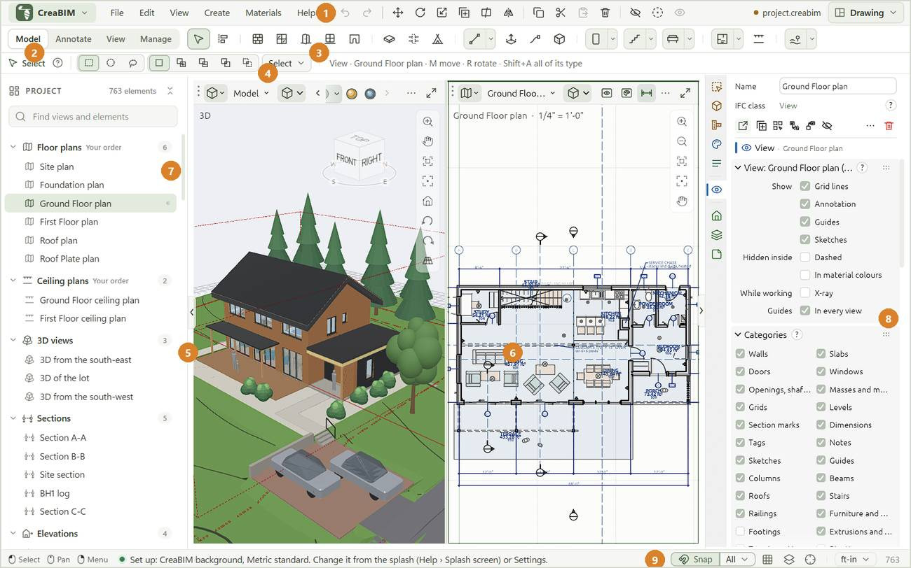
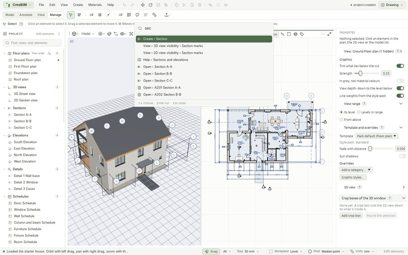

# The window at a glance

1. **The top bar**: the menus, the quick buttons, the file name and the workspace.
2. **The tool tabs**: *Model*, *Annotate*, *View* and *Manage*.
3. **The tool row** of the tab in front.
4. **The tool options strip**: how the tool in use works.
5. **A view area**: here the 3D view.
6. **Another view area**: here the ground-floor plan.
7. **The project browser**.
8. **Properties**, with its tabs down its left edge.
9. **The status bar**.

## The top bar

- **The CreaBIM menu** (the logo): About, updates, settings, the activity log and Exit.
- **Menus**: *File*, *Edit*, *View*, *Create*, *Materials* and *Help*. While one is open, slide to the next to switch.
- **Quick buttons**: Undo, Redo, Move, Rotate, Scale, Duplicate, Split, Mirror, Copy, Cut, Paste, Delete, Hide, Show only selected, Show everything. They do the same as the keys, so everything can be done with the mouse alone.
- **The file name**. A dot beside it means there are unsaved changes; the window's title shows a • too.
- **Workspace** (top right): a named layout of [view areas](interface#view-areas). See [Workspaces](interface#workspaces).

## The tool tabs and tool row

Four tabs hold the tools: **Model** (walls, doors, slabs, roofs, structure, objects, masses, rooms, site), **Annotate** (dimensions, tags, notes, details), **View** (levels, sections, elevations, crop boxes, references, sheets, schedules, graphic styles) and **Manage** (levels, grids, guides, project information, types, profiles, materials and the project's checks: doorways and layer joins). **Select** and **Align** are always there. Hover a tool for its name, its key and how to use it. `Shift+A` finds any tool by typing.

The tools row says **what** you make; the strip under it says **how**, and the values.

### Tool families

Related tools share one **split button**: **Drafting** (Line, Arc, Rectangle, Circle), **Structure** (Column, Beam, Footing), **Stairs** (Stair, Railing), **Furnishing** (Object, Catalogue) and **Site** (ground, earthworks, ways, hard landscape, services and planting). Tools used all the time (Wall, Door, Window, Slab, Roof, Pull) stay single.

- **The button** is the family's last tool used: one click brings it back. It is lit while one of the family's tools is on.
- **The arrow** beside it opens the family's panel: its tools under headings, each with its icon and key, the one in use ticked.
- **Keep on the bar**, at the foot of the panel, gives a tool its own button beside its family. Untick it to take it off again.

*Create* lists the same tools in the same families: the single tools first, then one submenu a family, then *Views and levels* (a new **Plan** or **Ceiling plan** of any level, sections, elevations, sheets, schedules) and *Annotation*.

## The tool options strip

The row under the tools shows the tool in use and what it can be set to: a wall's thickness, a dimension's direction. Fields keep a short label; switches and buttons are small icons. Hover one for its name, its key and what it does. When the window is too narrow, what does not fit goes into **⋯ More** at the right end.

**Draw by** is the same for every tool that draws an outline (slab, roof, ceiling, room, terrain, paving): its panel holds the **shape** (*Polygon* `1`, *Rectangle* `2`, *Fill room* `3`, *From sketch* `4`) and, for a polygon, its **edges** (*Line* `L`, *Arc* `A`). The Wall tool's Draw by holds its four shapes: *Straight*, *Arc*, *Circle* and *Rectangle*.

The **?** beside the tool's name opens a few lines on how to use it, with **Read more** for its page in this guide.

## View areas

The middle of the window is split into **areas**, as in Blender. Each area shows one thing under its own header: the 3D view, a plan, section, elevation, detail, sheet or schedule, the project's [notes](notes#the-notes-area), the [profile library](profiles), the [Masters](masters) of the sheets, the hatch [Patterns](graphic-styles#patterns), the kept [Renders](render#renders), the project's [Time](project-time), or the activity [Log](files#the-activity-log).

The header of an area, from the left:

- **The view-type menu**: what the area shows. Pick *3D view*, a kind of drawing, *Notes*, *Profiles*, *Masters*, *Patterns*, *Renders*, *Time* or *Log*. There is one 3D view: an area that asks for it while another shows it gets a drawing instead.
- **The view's name**: pick another view of the same kind.
- **The mode button**: *Object mode* or *Edit mode* (`Tab`). See [Edit mode](edit-mode). Sheets and schedules have none.
- **The view's own tools**: the cut height, drawing style, X-ray, what is hidden, and so on. Hover each for what it does.
- **⋯ More**: everything else about the view, such as *Zoom to scale* (1 mm on paper is 1 mm on screen) and *Pan and zoom with the other area of this view*.
- **The area button** at the right end: split the area side by side or one above the other, or close it (the area beside it takes its room).

You can also drag from an area's corner: into the same area to split it, into the one beside it to join the two. Drag the gap between two areas to share the room. `Ctrl+Space` shows the area under the pointer alone, and again brings the others back.

Every area pans and zooms on its own, even two areas showing the same plan: a detail close up beside the whole. To keep them in step, use *Pan and zoom with the other area of this view* in *⋯ More*; a small link then shows in the header. Selection and edits always show in every area.

## Workspaces

A **workspace** is a named layout of areas. Pick one from **Workspace** at the top right:

| Workspace | What it shows |
| --- | --- |
| *Model* | One 3D area, for modelling |
| *Drawing* | The drawing open now beside the 3D view |
| *Document* | The 3D view, the drawing open now, and the sheet it is placed on |
| *Sheets* | A sheet beside the drawing being placed on it |

*Save current layout…* keeps your own arrangement under a name, to pick from the same menu, where it can be deleted too. `Ctrl+PgUp` and `Ctrl+PgDn` step through the workspaces.

## The project browser (left)

Everything in the project, grouped: views by kind, sheets, schedules, levels, then walls, doors, materials, types, profiles and so on, each group with its own icon. Type in its search box to filter, by name or by mark (`D01`, `W05`). Click a row to select it, or to open a view or sheet. Double-click an element to zoom to it, or a type to see it on its own. `Shift` or `Ctrl` adds to the selection. Drag a view up or down to reorder its group. The button at the top folds every group shut, or opens them all. Drag the panel's edge to widen it.

The slim handle on its edge, or `Ctrl+[`, folds the browser to a narrow **rail** of its groups' icons. Click a group on the rail to list its items and pick one without opening the browser.

## Properties (right)

Everything about what is selected, and about the view and the project. The top is pinned while the rest scrolls: what the selected element is (its IFC class, with its own help), its name and mark, and buttons for what can be done with it.

A strip of **tabs** at its left edge shows only the tabs that apply, in three groups:

| Group | Tabs |
| --- | --- |
| What is selected | **Select** (always first: how picking works, and what is picked), **Element** (what it is and where: its type, place, sizes and material), its own tab when it has one (**Tree** for a plant, **Modifiers** for a mass, **Ground**, **Earthwork**, **Road**, **Drain**, **Path**, **Tank**, **Property** or **Paving** for the site's works, and **Parking** for a car park), **Junctions and booleans**, **Graphics** (its overrides), **Data (IFC)**. While a placing tool is on and nothing is selected: **Next element**, the settings of what the next click makes. |
| The view | **View** (the view in the area you last used, the 3D view included), **Visuals** (how the 3D view looks, lights and renders: see [Render and light](render)), **Trace and reference** (a drawing, with nothing selected), **Sheet** (a sheet in front), and the own tab of an area that isn't a view: **Render**, **Profile**, **Master**, **Pattern**, **Log** |
| The project | **Project** (information, standard, levels, materials), **Phases** (see [Phases](phases)), **Notes and to-dos** |

**Which tab holds what.** *Element* says what something is and where: its name, IFC class, place, overall size and material, the same rows for every kind. An element made by a generator or with many settings of its own has **its own tab** for how it is made (a plant's *Tree* tab). *View* and *Graphics* say how it is shown. A field is never in two tabs. Each tab starts with a **title line** naming it and what it is about ("Tree · how it grows"), and the Element tab ends with a link to the element's own tab when it has one.

The open tab stays when the selection changes. Picking a placing tool opens *Next element*; a first selection opens *Element*.

Each tab is made of sections. Click a section's heading to fold it: it stays folded, also next time. The **?** beside a heading says in a few lines what it is about. Drag a number's label sideways to change it, or click and type. Lengths can be typed in any unit (`1200`, `1.2 m`, `4'`). With several elements of one kind selected, a change goes to all of them, in one undo step.

Drag the panel's left edge to make it as wide as you like; in a narrow panel, rows wrap instead of running off. The slim handle on its edge, or `Ctrl+]`, folds it to its tab column; click a tab to open it again there.

## The status bar (bottom)

It starts with what each mouse button does over the view in use, and changes while `Shift`, `Ctrl` or `Alt` is held. Then what to do next, in words; a message cut short slides to show the rest when you point at it. Then:

- **Snap**, one split button: a click turns the object [snaps](snaps) on or off (`F3`); its arrow lists which snaps are on. Hold `Alt` while picking to suspend them.
- **Grid snap** (`Alt+S`), the **Workplane** and the **Pivot** for rotating and scaling. Each is a quiet icon while at its usual setting, and shows its word when you change it, so a glance says what is unusual.
- The **Units** menu (see [Units and number formats](units)).
- Chips that come and go: the settings held by *Pick up settings* (see [Create similar, pick up and apply](edit#create-similar-pick-up-and-apply)), the [project time](project-time) pill while time is kept, **Keep only** right after a box took several kinds, and **Open the folder** right after an export.

## Colours

Every colour field shows its swatch and its hex code. Click it for the colour picker: a wheel for hue and saturation with the value strip at its right edge, **HSV** or **RGB** sliders, a **Hex** field to type or paste a code into, and the colours used recently.

## The Help panel

This panel. It opens at the right of the window, beside your work. Drag its left edge to widen it, search with the box at the top, go back with the arrow, and close it with **×**, `Esc` or `F1`.

## Settings

*CreaBIM menu › Settings…* (`Ctrl+,`) holds what is yours alone: it never changes anyone's drawings, and goes with you, not with the project. Its categories:

| Category | What is in it |
| --- | --- |
| **Interface** | The theme; the **Interface scale**, from 80 % to 150 % (100 % is the default), to make every panel, menu and button larger or smaller; the **drawing paper** (follow the theme, always light or always dark; prints and PDFs are always on white); **Colour hints**, which tint the *Properties* tabs by subject; whether the **Splash** shows at start; which side the window **Buttons** sit on; and where the **Move, Rotate and Scale bar** sits: over the view, or by the pointer |
| **Viewport** | The **selection and grips colour** (*Orange*, or *Follow the theme*'s own accent), how grips look, Edit mode's edge width and vertex size, and the X and Y axes on the grid |
| **Navigation** | The mouse: *CreaBIM* (middle orbits, left boxes) or *Classic* (left drag orbits). **Wheel**: what a roll does in a view. *Automatic* zooms with a mouse wheel and pans with two fingers on a touchpad (a pinch zooms); if your mouse wheel pans instead, choose *Always zooms*. Or *Always pans* |
| **Snapping** | Grid snap spacing, and distance marks while dragging |
| **Project** | The project's units, saved with the project for everyone who opens it |
| **Keymap** | Every key, by what it does. `Ctrl+/` opens the list any time |

## Themes and the command palette

- *View › Theme* picks a colour theme: Graphite, Paper, Blueprint, Sage, Ink (high contrast), Solarized, Dark or Light. `Ctrl+Shift+T` goes to the next one. The choice is remembered.
- `Ctrl+K` opens the **command palette**: type part of any command, tool, view, help page or element name, then `Enter`. An element is selected and zoomed to.

