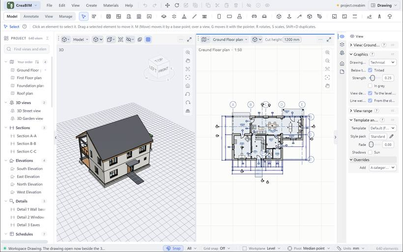
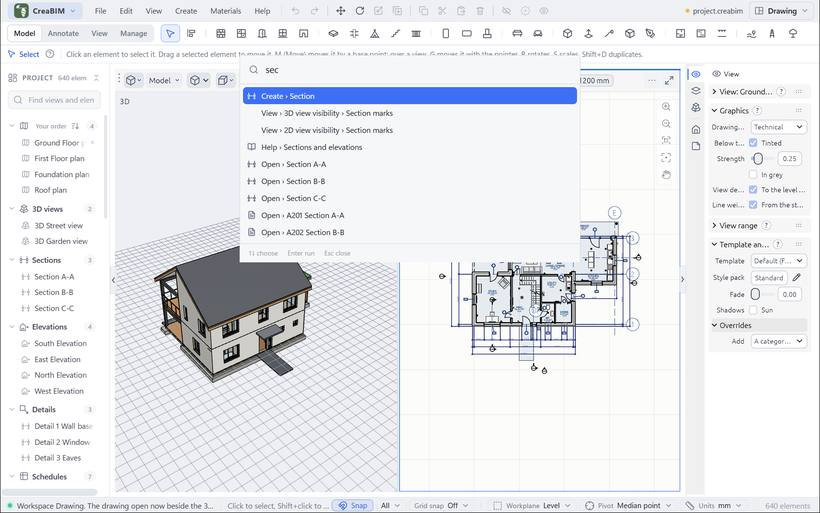

# The window at a glance

## The top bar

- **The CreaBIM menu** (the logo): About, updates, settings, the activity log and Exit.
- **Menus**: *File*, *Edit*, *View*, *Create*, *Materials* and *Help*. While one is open, slide to the next to switch.
- **Quick buttons**: Undo, Redo, Move, Rotate, Scale, Duplicate, Copy, Cut, Paste, Delete, Hide, Show only selected, Show everything. They do the same as the keys, so everything can be done with the mouse alone.
- **The file name**. A dot beside it means there are unsaved changes; the window's title shows a • too.
- **Workspace** (top right): a named layout of [view areas](interface#view-areas). See [Workspaces](interface#workspaces).

## The tool tabs and tool row

Four tabs hold the tools: **Model** (walls, doors, slabs, roofs, structure, objects, masses, rooms, site), **Annotate** (dimensions, tags, notes, details), **View** (levels, sections, elevations, crop boxes, references, sheets, schedules, graphic styles) and **Manage** (levels, grids, guides, project information, types, profiles, materials and the project's checks). **Select** and **Align** are always there. Hover a tool for its name, its key and how to use it. *Create* lists the same tools by name, and `Shift+A` finds any of them by typing.

## The tool options strip

The row under the tools shows the tool in use and what it can be set to: a wall's thickness, a slab's drawing mode, a dimension's direction. Fields keep a short label; switches and buttons are small icons. Hover one for its name, its key and what it does. When the window is too narrow, what does not fit goes into **⋯ More** at the right end.

The **?** beside the tool's name opens a few lines on how to use it, with **Read more** for its page in this guide.

## View areas

The middle of the window is split into **areas**, as in Blender. Each area shows one thing under its own header: the 3D view, a plan, section, elevation, detail, sheet or schedule, the project's [notepad](notes#the-notepad), or the [profile library](profiles).

The header of an area, from the left:

- **The view-type menu**: what the area shows. Pick *3D view*, a kind of drawing, *Notes* or *Profiles*. There is one 3D view: an area that asks for it while another shows it gets a drawing instead.
- **The view's name**: pick another view of the same kind.
- **The mode button**: *Object mode* or *Edit mode* (`Tab`). See [Edit mode](edit-mode). Sheets and schedules have none.
- **The view's own tools**: the cut height, drawing style, X-ray, what is hidden, and so on. Hover each for what it does.
- **⋯ More**: everything else about the view, such as *Zoom to scale* (1 mm on paper is 1 mm on screen) and *Pan and zoom with the other area of this view*.
- **The area button** at the right end: split the area side by side or one above the other, or close it (the area beside it takes its room).

You can also drag from an area's corner: into the same area to split it, into the one beside it to join the two. Drag the gap between two areas to share the room. `Ctrl+Space` shows the area under the pointer alone, and again brings the others back.

Every area pans and zooms on its own, even two areas showing the same plan: a detail close up beside the whole. To keep them in step, use *Pan and zoom with the other area of this view* in *⋯ More*; a small link then shows in the header. Selection and edits always show in every area.

## Workspaces

A **workspace** is a named layout of areas. Pick one from **Workspace** at the top right:

| Workspace | What it shows |
| --- | --- |
| *Model* | One 3D area, for modelling |
| *Drawing* | The drawing open now beside the 3D view |
| *Document* | The 3D view, the drawing open now, and the sheet it is placed on |
| *Sheets* | A sheet beside the drawing being placed on it |

*Save current layout…* keeps your own arrangement under a name, to pick from the same menu, where it can be deleted too. `Ctrl+PgUp` and `Ctrl+PgDn` step through the workspaces.

## The project browser (left)

Everything in the project, grouped: views by kind, sheets, schedules, levels, then walls, doors, materials, types, profiles and so on, each group with its own icon. Type in its search box to filter, by name or by mark (`D01`, `W05`). Click a row to select it, or to open a view or sheet. Double-click an element to zoom to it, or a type to see it on its own. `Shift` or `Ctrl` adds to the selection. Drag a view up or down to reorder its group. The button at the top folds every group shut, or opens them all. Drag the panel's edge to widen it.

The slim handle on its edge, or `Ctrl+[`, folds the browser to a narrow **rail** of its groups' icons. Click a group on the rail to list its items and pick one without opening the browser.

## Properties (right)

Everything about what is selected, and about the view and the project. The top is pinned while the rest scrolls: what the selected element is (its IFC class, with its own help), its name and mark, and buttons for what can be done with it.

A strip of **tabs** at its left edge shows only the tabs that apply, in three groups:

| Group | Tabs |
| --- | --- |
| What is selected | **Element** (its type, sizes and build), **Modifiers** (for a mass), **Junctions and booleans**, **Graphics** (its overrides), **Data (IFC)**. While a placing tool is on and nothing is selected: **Next element**, the settings of what the next click makes. |
| The view | **View** (the view in the area you last used), **Trace and reference**, **3D view** (what it shows, crop boxes) |
| The project | **Project** (information, levels, materials), **Notes and to-dos** |

The open tab stays when the selection changes. Picking a placing tool opens *Next element*; a first selection opens *Element*.

Each tab is made of sections. Click a section's heading to fold it: it stays folded, also next time. The **?** beside a heading says in a few lines what it is about. Drag a number's label sideways to change it, or click and type. Lengths can be typed in any unit (`1200`, `1.2 m`, `4'`). With several elements of one kind selected, a change goes to all of them, in one undo step.

Drag the panel's left edge to make it as wide as you like; in a narrow panel, rows wrap instead of running off. The slim handle on its edge, or `Ctrl+]`, folds it to its tab column; click a tab to open it again there.

## The status bar (bottom)

What to do next, in words, on the left. Then the **Snap** switch and the list of [snaps](snaps), **Grid snap** (`Alt+S`), the **Workplane**, the **Pivot** for rotating and scaling, the **Units** menu (see [Units and number formats](units)) and the number of elements in the project.

## The Help panel

This panel. It opens at the right of the window, beside your work. Drag its left edge to widen it, search with the box at the top, go back with the arrow, and close it with **×**, `Esc` or `F1`.

## Themes and the command palette

- *View › Theme* picks a colour theme: Graphite, Paper, Blueprint, Sage, Ink (high contrast), Dark or Light. `Ctrl+Shift+T` goes to the next one. The choice is remembered. *Settings › Appearance › Drawing paper* chooses whether drawings follow the theme (dark paper in a dark theme), or are always light or always dark. Prints and PDFs are always on white.
- `Ctrl+K` opens the **command palette**: type part of any command, tool, view, help page or element name, then `Enter`. An element is selected and zoomed to.

- *View › Classic panels* switches to plain built-in panels, for computers where the new interface can't start.
