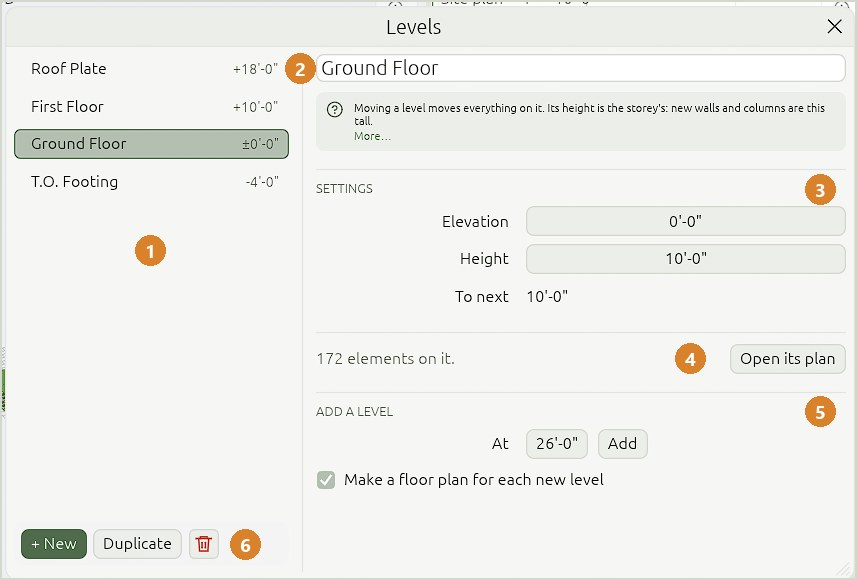

# Levels

A **level** is a floor of the building at a height, such as *Ground Floor* at ±0 or *First Floor* at +3000. Each element stands on a level, at an offset from it. Move the level and everything on it moves too. Each level usually has its own floor plan.

## The Levels window

Open it with *View › Levels…* (also in *File*), the **⋯** on the browser's *Levels* group, *Levels…* in a level's *Properties*, or by picking the Level tool anywhere but a section.

1. **The levels**, down the left, highest first, with their elevation. Click one to pick it.
2. **Its name**: type to rename it.
3. **Settings** for the picked level: its **Elevation**, its **Height**, and **To next**, the gap up to the level above, with **Fit** when the two differ.
4. How many elements are on it, and **Open its plan** (or **Make a floor plan** when it has none).
5. **Add a level**: type an elevation in **At** and click **Add**. With *Make a floor plan for each new level* ticked, each comes with its floor plan.
6. **+ New** adds one a storey above the highest, as tall as it. **Duplicate** copies the picked level one storey up: *The level only*, or *With everything on it*. The bin deletes it, and asks what happens to what is on it: *Move them to another level, keeping them where they are*, or *Delete them with the level*.

Plans named after a level follow when you rename it ("Level 2 plan" becomes "Roof plan").

## Levels in sections

In a section or elevation, each level is a line with a head showing its name and elevation.

- Drag a level line (or its head) up or down to move the level and everything on it. It snaps to model points.
- With the **Level** tool, click where the new level's line starts (that sets its height), then where it ends. Its floor plan is made with it.

## Walls tied to levels

A wall's top can be set to *Up to* a level: then the wall grows or shrinks when that level moves. See [Walls](walls#base-and-top).

## Copying and moving to other levels

Draw something once on one level, then put it on others without drawing it again.

1. Select what to copy: walls, slabs, columns, beams, stairs, footings, furniture and fixtures, or a whole floor (`Ctrl+A` in its plan).
2. Right-click and pick **Copy to levels…**. It is also in the *Edit* menu.
3. Tick the levels you want, or use **All above** or **All below**, then click **Copy to** *n* **levels**.

Each copy sits on its new level the same way the original sits on its own: same place in plan, same base offset. A top tied to a level moves up or down by the same number of storeys. For example, a wall on Level 5 that goes *Up to* Level 6, copied to Level 3, goes up to Level 4. If there is no level that far up, the top is left unconnected but keeps its height. Doors and windows go with their walls, and footings go with their walls and columns. All the copies are one step: `Ctrl+Z` undoes them together.

**Move to level…** does the same thing, but moves the selection instead of copying it. Pick the level, and the elements move onto it with their doors, windows and footings.

**Edit › Paste aligned to level** pastes what you copied with `Ctrl+C` onto the level you pick, at the same place in plan. Use it to bring something from another level or another file.

## Columns over several levels

A column has a **base level** and a **top level**, so it can run through several storeys. See [Columns](columns-beams#over-several-levels).

## Underlay

A plan can show another level faintly underneath, to trace and snap to. Pick it in the tool options strip (*Underlay*: None, Level below, Level above or any level), in the view's *Properties*, or *View › Underlay*.
