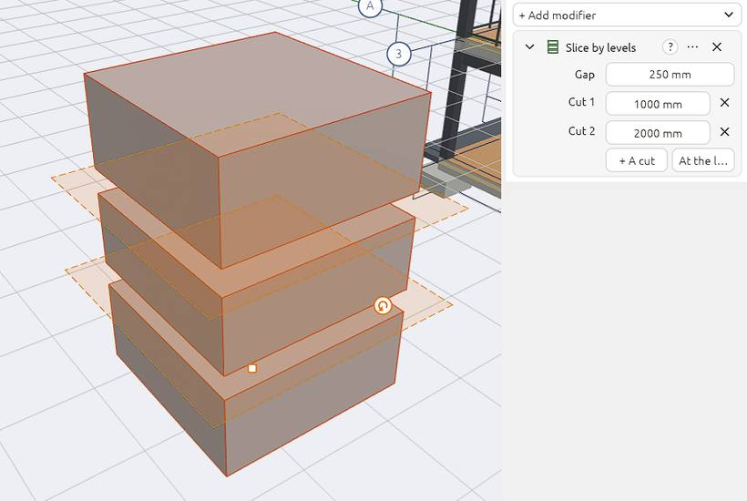

# Masses, modifiers and booleans

A **mass** is a free 3D shape you can model like in Blender: for early design studies, or anything that isn't a wall, slab or roof.

## Making a mass

- Pick the **Mass** tool and click to place a box.
- Or extrude a closed [sketch](sketches) with `E`.

## Editing its shape

- Click a face in the 3D view to select it, then press `E` to extrude it, or move it with `G`.
- Use [Move face](move#move-a-face-push-and-pull) to push or pull a face by a typed distance.
- Rotate, tilt and scale it with `R` and `S` (see [Move, rotate and scale](move)).

Selected, a mass shows only its main grips: its base point (moves it), its turn grip and the clicked face's push and pull arrow. Every face's arrow, its corners, its edges and the lift arrow come in [Edit mode](edit-mode) (`Tab`).

*Properties* shows its **Location**, **Rotation (XYZ Euler)** and **Scale**, as Blender's Transform panel: a mass turns about X, Y and Z, so a shape drawn on a wall turns about the wall's axes.

Give a mass an IFC class in *Properties* (such as `IfcRoof`) and it is exported as that.

## Mesh edit

The *Mesh edit* section of *Properties* works on the face you clicked: **Extrude** pushes it out with new sides (`E`), **Move** slides it, **Taper** shrinks it, and **Inset** draws a smaller face inside its edges, by the distance in *Inset by*. Inset makes a reveal, a recessed panel or a parapet: inset the roof face, then push it down. These change the mesh under its modifiers.

## Modifiers

Modifiers change a mass's shape without touching it, so you can change or remove them later. Select a mass and open the **Modifiers** tab of *Properties* (the wrench), then **Add modifier**. The menu groups them under *Repeat*, *Facade*, *Shape* and *Deform*, each with its icon; hover one for what it is for:

| Modifier | What it does |
| --- | --- |
| **Array** | Copies in a row (a pergola's rafters): a count, or to fit a length; each copy can step by its own size, turn and grow |
| **Radial array** | Copies round a centre, picked in a plan or set to its middle: seats round a table, columns round a rotunda |
| **Path array** | Copies along a sketch or a guide: balusters, posts along a curve |
| **Mirror** | A mirrored copy, its plane at the middle or at an edge |
| **Bevel** | Rounds or chamfers the upright corners: all of them, the outside or the inside ones |
| **Shell** | Hollows it to a thickness, open at the top, the bottom or both |
| **Solidify** | Gives a surface a thickness, growing in or out |
| **Slice by levels** | Floors cut out of the mass, with a gap between: a quick tower study |
| **Panelize** | Facade panels with joints on its upright, rectangular faces |
| **Louvres / fins** | Fins on the sides facing north, east, south or west, at an angle |
| **Taper** and **Twist** | Narrows it towards the top, or turns it as it rises |
| **Smooth** | Smooths it; its *Split* kind keeps the shape and only adds faces |

Each modifier is a card, as in Blender. Its icon switches it on and off, and folded it shows a one-line summary. Rename it, and use its `…` menu for **Apply** (make it part of the shape), **Duplicate**, **Move up** and **Move down**; the cross removes it. Open, its settings are rows, and the `?` on the card explains it. The card you are working in shows its guides in every view: the radial centre and circle, the mirror plane, the slice floors as see-through planes. The *Element* tab says how many modifiers the mass has.

## Booleans: cutting one shape from another

Select a wall, slab or mass, then under *Booleans* pick *Subtract…* and the element to cut away. The cutter stays as a see-through ghost you can select and move to change the cut. Switch it to *Union* or *Intersect*, or *Remove* it.
