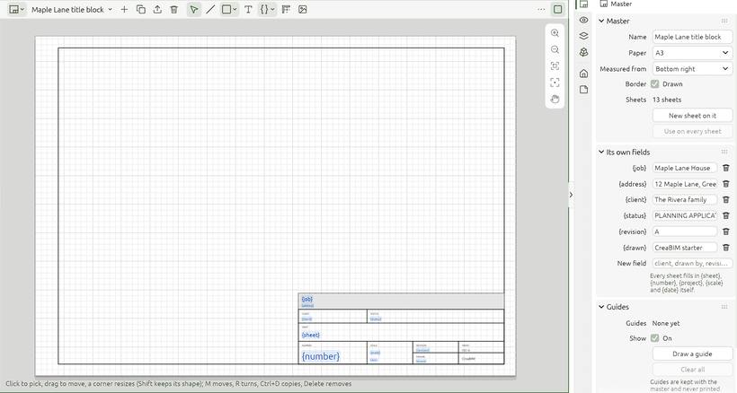

# Masters: title blocks

A **master** is the drawing every sheet sits on: its paper, border and title block, with the project's name, the sheet's number and the date filled in by each sheet. Masters are drawn in a view of their own, the **Masters view**, with lines, shapes, text, fields, pictures and logos.

## Opening the Masters view

- Pick *Masters* in any area's view-type menu, or open the *Masters* group of the project browser.
- From a sheet's *Properties*, click **Edit the master**.

The header picks a master, and holds **+** (a new master from *Standard A3*, *Minimal A3* or blank), *Duplicate*, *Export SVG* and *Delete*. **Bring in an SVG or DXF…** takes a frame or title block drawn in any drawing program.

## Drawing on a master

| Tool | What it makes |
| --- | --- |
| **Select** | Pick, drag, or resize by a corner (`Shift` keeps the proportions) |
| **Line** | Click corners; `Enter` or a right-click ends it, the first corner again closes it |
| **Shape** | A rectangle (two corners), a circle (its centre, then a point on it) or an ellipse (two corners of the box round it), from its drop-down |
| **Text** | Click where it goes; its words, size and alignment are in *Properties* |
| **Field** | Text each sheet fills in: `{sheet}`, `{number}`, `{project}`, `{scale}`, `{date}`, or a field of your own (client, drawn by, checked…) |
| **Guide** | Two clicks; nearly level or upright, it goes straight |
| **Picture** | A logo, a stamp or a background: an SVG comes in as a crisp vector logo, a PNG or JPEG as a picture |

One rule for every tool: `Enter` or a right-click ends what is drawn and keeps it, `Esc` drops the piece in progress, and either with nothing going puts the tool down.

Everything snaps to what is drawn, to the margins, to a millimetre grid and to the guides. `M` moves what is picked, `R` turns it, `Ctrl+D` copies it 5 mm along and `Delete` removes it. `Ctrl+]` brings it over everything else, `Ctrl+[` sends it under. `Ctrl` + middle-drag zooms.

## The Master tab in Properties

With the Masters view in front, *Properties* shows the master:

- **Paper**, and **Measured from**: the corner the title block is measured from;
- the **border** and its **margins** (left, bottom, right, top);
- **its own fields**, named here and filled in per sheet;
- **Guides**: how many, show or hide them, draw one, clear them all. Guides are kept with the master and never printed;
- **Pictures and logos**, with each one's size, opacity and, for a logo, one colour;
- the **picked** line, shape, text, field or picture, with its pen, fill colour, opacity and words.

**New sheet on it** makes a sheet using this master; **Use on every sheet** gives it to every sheet of the project in one undo step. Deleting a master sends its sheets back to the built-in block.

Masters print on sheets, in PDF and in SVG export exactly as drawn. On dark paper black lines show light while you work, and still print black.

See also [Sheets and title blocks](sheets).
