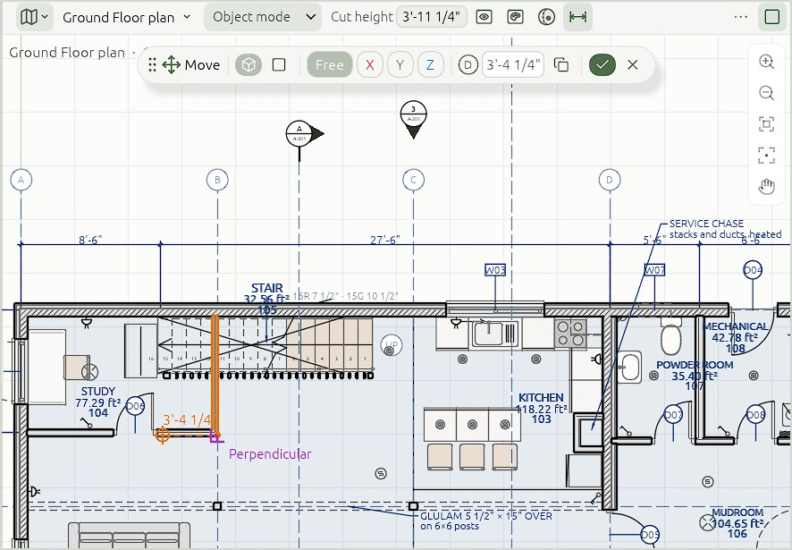

# Move, rotate, scale, stretch, mirror and offset

## Move by a base point

The most precise way to move something, as in most CAD programs.

1. Select what to move, then press `M` (or the Move button, *Edit › Move*, or the right-click menu). With nothing selected, Move asks you to click what to move first.
2. **Base point**: click a point to move it by, such as a corner. A snap marker shows what you will catch. Nothing moves yet.
3. **Follow**: the selection follows the pointer, with a dashed line showing the distance.
4. **Place**: click where the base point should go. It snaps to corners, midpoints, crossings and grid lines.

While it follows the pointer:

- Type a distance, such as `2400`, `2.4 m` or `8'-6"`, and press `Enter`: it moves that far in the direction you point. A bare number is in the project's units.
- Press `X`, `Y` or `Z` to keep to that axis; again to free it. Hold `Shift` to keep it square.
- Press `Ctrl` to leave a copy behind with every click.
- `Esc` or right-click steps back, and again cancels.

The **Move bar** at the top of the view does the same with the mouse: axis chips for *X*, *Y* and *Z* in their colours (red, green and blue, as the axis lines in the view), a **D** badge for the distance, *Copy*, *Finish* and *Cancel*. Rotate and Scale use the same bar. Drag it by its grip if it is in the way; a double-click puts it back. To have it as a small palette by the pointer instead, see *Settings › Interface › Move, Rotate and Scale bar*.

A move is one undo step. Doors and windows go with their wall, and walls joined to a moved wall stretch to stay joined.

## Move a face (push and pull)

Press `F` during Move (or click **Face** on the Move panel) to move one face of an element instead of all of it.

- In 3D, point at the face itself. In a plan or section, point at the element's edge: it stands for the face square to the paper.
- Click, then move the pointer or type a distance. A minus sign pulls the face in.

What it changes depends on the face: a wall's end changes its length, its top its height and its side its thickness; a slab's top its thickness; a door's jamb its width; a column's side its size; a mass's face moves its points; an extrusion drawn on a face gets deeper square to that face from its outer face, or wider from a side. Press `F` again for whole elements.

## Up and down in the 3D view

In the 3D view a move slides on the level. To go up or down, take the pointer straight up or down from the base point: the move keeps to the vertical, a blue line shows it and the **Z** chip lights. Take the pointer off the line and it is back on the level. `Z` holds the vertical wherever the pointer is.

The **X** and **Y** chips light the same way while the pointer runs along one of those axes through the base point; `X` or `Y` holds it. A corner, a middle or an edge under the pointer still takes the move, and at its own height: snap to a corner higher up and what you move goes up to it. The status line says how far up or down it went. Held to `Z`, a snap sets only the height. Looking straight down, up is not a direction on the screen, so there the move stays on the level.

## Pull: P

**Pull** takes the face under the pointer, with nothing selected first. Pick it on the Modify bar, from the right-click menu, or press `P`.

- Point at a face (in a plan or section, at the element's edge) and click on it.
- Move the pointer out or in, or type a distance and press `Enter`. A minus sign goes in.
- The tool stays in hand for the next face. `Esc` leaves it.

What it does depends on what the face belongs to:

- A drawn [sketch](sketches), pointed at in the 3D view (on one of its lines, or anywhere inside a closed one): a closed outline becomes a solid, an open line a surface along it. The sketch is used up.
- A flat shape standing alone becomes a solid.
- A face of a box or a prism lengthens it, with no new edges. A face whose sides lean grows new sides.
- A wall, a column, a beam, a roof, a stair, a door or a window changes its own size, as with *Move a face*. Its values in *Properties* follow.
- A slab's top or underside moves the whole slab up or down: how thick it is belongs to its type.

## Grab with the pointer: G

With the pointer over a view, `G` grabs the selection and it follows the pointer straight away, from the snapped point under the pointer. Click or `Enter` to finish. Axis keys, typed values and `Esc` work as in Move.

## Drag

Press on a selected element and drag it. Its grab point and where it lands both snap. A small movement doesn't count, so a click never moves anything. See also [Handles and grips](handles).

## Rotate: R

1. Select, then click *Rotate* or press `R` over a view.
2. Click the **centre**, then a **reference direction**, then the **new direction**. Each snaps.
3. Or type an angle, such as `30`, and press `Enter`.

While you turn, a **protractor** shows round the centre: where you started, how far you have turned, and the angle as a number.

The tool's bar sets how it turns:

- **Step**: *Free* turns to any angle (hold `Ctrl` for 15° steps), and 0°, 90°, 180° and 270° lock as you pass them; the angle reads *(locked)* while it holds. Or *In 15° steps*, *In 45° steps* or *In quarter turns*.
- **Orientation**: where 0° is. *Local*, the start, is the element's own front as it stood when picked up; *Global* is the plan's axes, 0° to the east.
- The pivot menu sets what it turns about (see [The pivot](move#the-pivot)).

Press `R`, then `X` or `Y`, to tilt a mass about that axis. In a section, R tilts about the axis you look along. Walls and slabs stay upright.

With the workplane on a face, Move slides along the face and Rotate turns about the face's normal, so a part drawn on a wall turns on the wall.

Rest the pointer on a selected object's round turn dot and the protractor shows around it. Press on the dot, or anywhere on the protractor's ring, and drag around it to turn the object.

**Orientation**, in Rotate's row, sets where the protractor counts 0° from:

- *Global*: the plan's east.
- *Local*: the object's front.
- *Normal*: a face picked in Edit mode.
- *View*: the screen's right.
- *Cursor*: the direction from the pivot cursor to what turns.
- *Host*: along a door's or window's wall, or the wall nearest an object.

## Scale: S

`S` over a view scales the selection with the pointer, or by a typed factor. Press `X`, `Y` or `Z` to scale along one axis only: a wall changes its height, a slab its thickness.

The row under the toolbar sets how it scales, and keeps each choice:

- **Pivot.** *Opposite corner* scales about the corner across from the one you take it by, which stays where it is. Hold `Alt` to scale about the centre instead. *Centre* always uses the centre, or the pivot picked in the status bar.
- **Keep.** *Proportions* scales the same every way. *Free* widens and deepens it each by how far the pointer goes.
- **By.** *Factor* follows the pointer or a typed factor (`2` doubles it). *Reference*: click the two ends of a length you know, then type its true length and press `Enter`. It scales about the first end. Use it to bring an imported plan to its true size.
- **Step.** The factor goes in steps of 0.05, 0.1 or 0.25, or freely.

While it scales, the outline it started from stays faint, the new one shows its width and depth, and the factor sits by the pointer.

A selected piece of furniture or fitting shows a bracket at the corner under the pointer. Drag the bracket to scale it from the opposite corner. It then has a size of its own, and its type stays as it was. Click the bracket without dragging for a row of actions: turn it 90° either way or 180°, *Mirror* or *Scale*.

## Stretch: Shift+S

Stretch moves part of several things at once, as AutoCAD's and Revit's do. Press `Shift+S`, or the **Stretch** button beside Scale, then drag a box in a plan.

- Every corner and end inside the box lights up in orange as you drag, across walls, beams, slabs, roofs, outlines, lines and grid lines, with a count by the pointer.
- Let go, click a base point, then where it goes, or type a distance, as with Move.

What lies wholly inside the box moves. What the box crosses stretches: only its corners or ends inside move, and the rest stays. Walls joined to an end that moves follow it, and rooms follow their walls. The whole stretch is one undo step. `Esc` stops.

## Duplicate: Shift+D

`Shift+D` copies the selection and starts moving the copy.

## Mirror

`Ctrl+M`, the Mirror button beside Move, Rotate and Scale, *Edit › Mirror* or the right-click menu flips the selection across a line. Its row under the toolbar says which line:

- **Pick a line**: point at a line already in the drawing (a wall's face or edge, a grid line, a centre line, any line drawn) and click. It is lit while the pointer is on it.
- **Draw a line**: click two points, at any angle, where the line is needed.
- **Its centre ↔** flips it left for right in place, across its own centre line (a chair, a door, a bathroom); **Its centre ↕** flips it front for back. Click or press `Enter` to place.
- **Copy**: ticked, it makes a mirrored copy and keeps the original; cleared, it flips the original. The tick is remembered, and `Ctrl` swaps it for the moment.

When drawing the line:

- `Shift` keeps the line to 15° steps from the axes, and a typed angle, then `Enter`, sets it.
- With the workplane on a face, the line lies on the face, and a part on the face is flipped across it and still stands out of the face.
- Walls keep their outside out. Objects and columns move and turn to match, but keep their own shape.

## Offset

*Edit › Offset* makes a copy a set distance to one side. Move the pointer to the side you want and click, or type a distance and press `Enter`; `Shift` rounds to 50 mm. `Ctrl` changes the original instead of making a copy.

A closed outline (slab, roof, ceiling, shaft, extrusion) grows outwards or shrinks inwards. A line (wall, beam, grid, room separator, strip footing, railing) moves sideways. A sketch, an extrusion drawn on a face or a sweep offsets on its own plane.

## The pivot

Rotate and scale turn about the **pivot**, chosen in the status bar or *Edit › Pivot*: the median point, the bounds' centre, each element's own origin, the active element, or the **pivot cursor**. `Shift+right-click` anywhere places the cursor and makes it the pivot.

## Extrude: E

Select a face of a mass in 3D, or a closed [sketch](sketches), and press `E` to extrude it.
