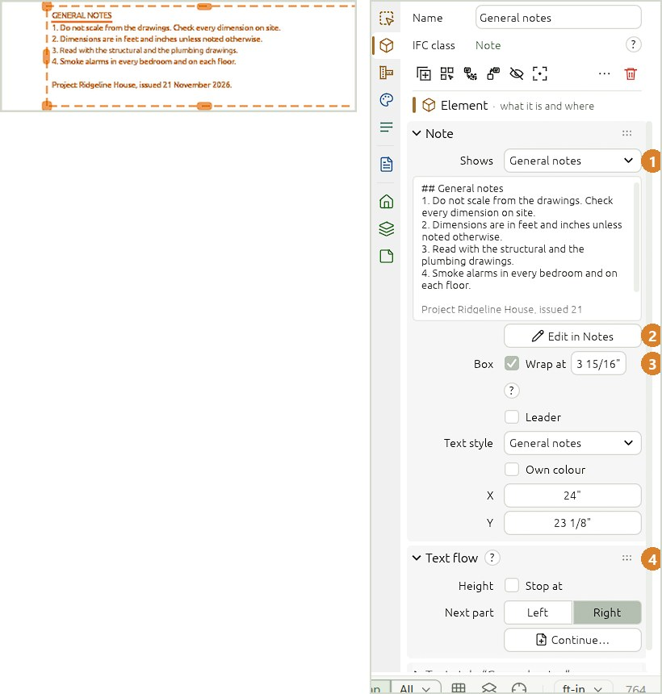
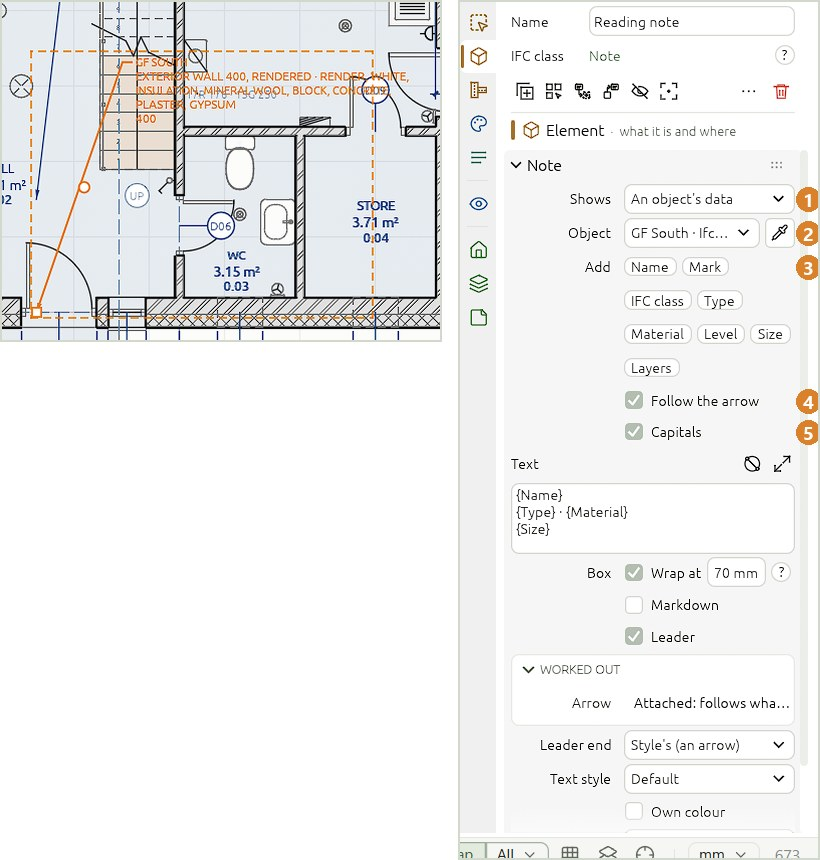
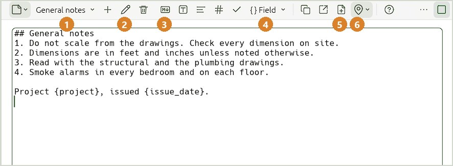
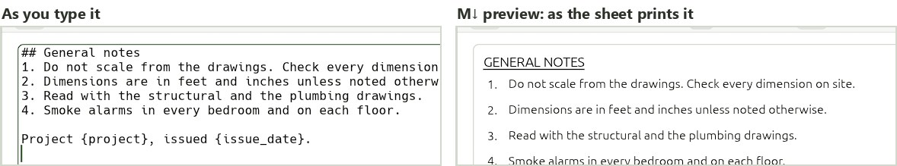
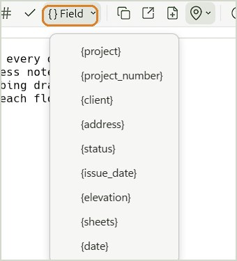
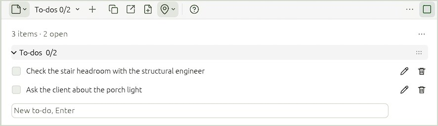

# Notes

A **note** is free text on a drawing or a sheet, with or without a leader arrow pointing at something. The project also keeps its **notes** in one place, the **Notes area**: general, structural, electrical and plumbing notes, your own sections, and your drafts and to-dos. Any of them can be placed on sheets.

## Writing a note

1. Pick the **Note** tool (`N`, with nothing selected).
2. With **Leader** on (in the tool options), click what the note points at, then where its text goes. With *Leader* off, one click places the text.
3. Type the text in *Properties*: the text box is ready to type into. `Enter` adds a line.

If the leader's point snapped onto an element, it follows that element when it moves.

## Notes that read an object

A note can show an object's data instead of words you type, and keep it up to date. In *Properties*:

1. **Shows**: *An object's data*.
2. **Object**: choose it from the list, searched by name, mark, IFC class or GlobalId, or click the pipette and pick it in a view (`Esc` stops picking).
3. **Add**: puts one of its fields in the text: `{Name}`, `{Mark}`, `{IFC class}`, `{Type}`, `{Material}`, `{Level}`, `{Size}` or `{Layers}`. Type words round them as you like, such as `Wall {Mark}: {Layers}`. `{Size}` is a wall's or slab's thickness, a beam's width × depth, and a door's or window's width × height. A field the object hasn't got reads "—".
4. **Follow the arrow**: on, the note reads whatever its arrow is attached to, so drag the arrow onto another element and the note reads that one instead. Off, it reads the object chosen above.
5. **Capitals** sets the words in capitals, as drawing notes often are.

Change the object (rename it, give it another material, change its layers) and the note follows. If the object is deleted, its fields read "—" and *Properties* says the object is gone.

*Shows* can also be one of the project's notes sections from the Notes area (see [Notes on sheets](notes#notes-on-sheets)), or *Its own text*, the usual.

## Long text

- **Wrap at**: give the note a width on paper, and its lines wrap to it. Off, each line runs as long as it is.
- **Markdown**: the note reads `# heading` (in capitals, underlined), `- ` bullets, `1. ` numbered lines and `- [ ]` / `- [x]` checkboxes. A list item's later lines are set in under it. `**bold**` and `*italic*` marks are dropped on paper.
- The text box in *Properties* scrolls. The first button beside it pops it out into a large editor. The second, **Ø**, adds a sign or word drawings often carry: ± Ø ° ² ℄ ′ ″, TYP., CLR, U.N.O. and others. Double-clicking a note on a sheet opens the large editor too.
- An area set to **Notes** (its view-type menu) shows the selected note's text large, as Blender's text editor does, with *Lists and headings*.

## On sheets

Pick the Note tool on a sheet, outside any viewport, to write on the paper itself: general notes, title notes. Its **X** and **Y** can be typed, in millimetres on the sheet (in a view, as lengths).

## Moving and styling

With the Select tool, drag a note's text to move it, its square grip at the arrow to move the leader's end, and its round grip to bend the leader at an elbow (**Straighten the leader** in *Properties* takes the elbow out). **Leader end** in *Properties* picks an arrow, a dot, a slug or nothing for this note. A *Curved* leader comes from the note's style. Pick a **Style**, or an *Own colour*, as for dimensions; the note's text style can be edited in its own section. See [Annotation styles](styles).

Notes are a visibility category: a view can hide them (see [Visibility](visibility)).

## The Notes area

The project's notes are a list of **sections**. The dropdown in the Notes area's header switches between them:

- **General notes**, **Structural notes**, **Electrical notes**, **Plumbing notes**, and any of your own: the **+** beside the dropdown adds one and lets you name it, the pencil renames the one shown (or double-click its name), the bin deletes it. A section's heading is its name, in capitals.
- **Drafts** and **To-dos**, kept apart at the end of the list because they are yours, not the drawing's. Drafts are whatever you are thinking; to-dos tick off.

Open the Notes area from the **Notes** group of the project browser, or set an area's view-type menu to **Notes**. Its header carries every button: the Markdown switch, the line buttons, **{ } Field**, copy, pop out (a window of its own), **Place on a sheet**, **Placed on** (the sheets that show it, with their count) and help; what doesn't fit goes in its ⋯ menu.

The **Notes and to-dos** tab of *Properties* has two folds. **Note**: the dropdown, + and delete, the buttons used most, a short box that scrolls, and **Place on a sheet**; its last button opens the notes in an area of their own. **Placed on**: every block that shows the section, a click opening its sheet with the block picked; tick blocks to pick them all or take them off their sheets (the section stays). You can type in Properties and the area at once.

### Writing

A section is written in Markdown, and an empty one shows a short guide:

- `## ` starts a heading: capitals, underlined on paper.
- `- ` starts a list, `1. ` a numbered line, `- [ ] ` a box to tick.
- `**bold**` and `*italic*` print bold and italic.
- **{ } Field** (below) puts in a field that fills itself on the sheet: `{project}`, `{project_number}`, `{client}`, `{address}`, `{status}`, `{issue_date}`, `{elevation}` (project zero above datum), `{sheets}` (every sheet's number) and `{date}` (today's date).

The **M↓** button switches between the Markdown you type and a **preview** of the section as the sheet prints it, fields filled; click the preview to type again. Paste (`Ctrl+V`) from Word or a web page keeps headings, bold, italic and lists, written as Markdown. The copy button copies the whole section.

### Notes on sheets

**Place on a sheet** puts the open section on the sheet in front, at its top right, as a text block that stays **linked**: edit the section and every sheet that shows it updates, so the same notes on five sheets stay one text. Placed to-dos print with their boxes. New projects have a plain **General notes** text style, and placing uses it.

Select the block on the sheet: a dashed box shows the block, and *Properties* shows **Shows** (which section, or *Its own text*), a preview of the section, and **Edit in Notes**. Double-clicking the block opens its section too. Wrap width, style, colour, leader and position are set there, as for any note. Deleting a section leaves its sheet notes with the text they showed. Zoomed far out, lines too small to read show as faint bars.

### Long notes

A block can have a **Height**: tick *Stop at* in its *Properties*, or drag the grip at the foot of its dashed box. While it shows **Whole**, all of its text is drawn, past the height if need be, and a red mark at its foot says how many lines run past.

**Continue…** carries the text on in a new block, a column beside the last one (**Next part**: *Left* or *Right*), and turns the note **Continued**: the first block stops at its height and the rest flows on. Drag the new block anywhere, or pick another sheet for it in its *Sheet* row; its **Title** is none, *(continued)*, the section's name, or the name with *(continued)*. Edit the section and the lines flow from block to block; if they still don't all fit, the last block shows the red mark. **Whole** folds it back into the first block, the others kept and empty, and **Continued** puts them back.

### Drafts and to-dos

- Type in the line at the bottom and press `Enter` to add an item.
- Each item is one row: a tick (to-do) or a dot (draft), its first line, then its link, edit and delete at the right. Click a row's text to edit it in place; click away to close it.
- **Link to the selection** ties an item to the element selected, or else to the view in front. Its link button then selects the element or opens the view.
- The **⋯** menu: *Copy all*, *Save as text (.txt)…*, *Save as Markdown (.md)…* and *Remove the done to-dos*.
