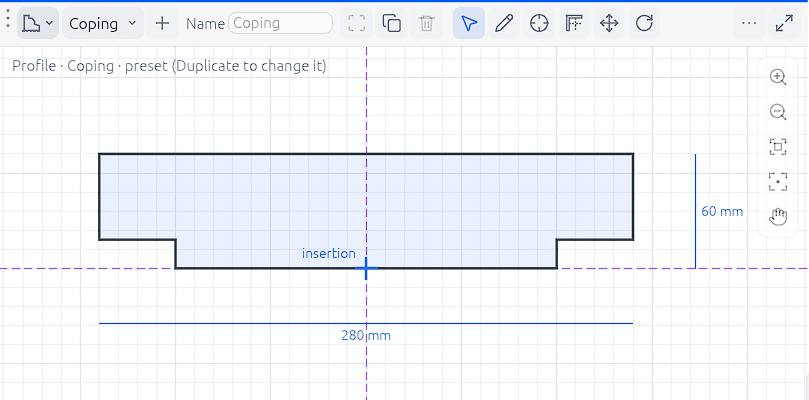

# Profiles

A **profile** is a cross-section you draw once and use many times: a coping, a cornice, a gutter, a skirting, a steel section. Sweeps carry it along a path, extrusions push it straight up, and columns, beams and railings can take it as their section.

## The profile library

Every project has a library of profiles: twelve **presets** (Coping, Plinth, Bar, Cornice, Skirting, Gutter, Handrail, I-section, Channel, Angle, T-section and Tube) and the project's own. Open it from:

- *Manage › Profiles*;
- the *Profiles* group of the project browser;
- the view-type menu of any [area](interface#view-areas): *Profiles* shows the library and its editor large, as a view of its own.

A preset can't be changed or deleted: **Duplicate** it to make your own copy, then change that.

## The Profile view

A profile is drawn like any drawing, in a **Profile view**: an area with a grid, guides, snaps, typed lengths and the zoom column, on light or dark paper as your theme. Its header holds:

- **the profile list**, with a small picture of each: pick a profile to edit;
- **+ New** (a square to start from), **From the selection** (sketches on any plane, slabs or extrusions, made into one profile), **Duplicate** and **Delete**;
- the **Name** field: type a new name and press `Enter`. Everything made with the profile keeps it;
- the tools: **Select**, **Draw**, **Insertion**, **Guide**, **Move**, **Rotate**, **Align** and **Pick void**;
- **Trace**: a picture, a DXF drawing or a view of the project under the profile, to draw over;
- **Shape**: whether the picked shape is closed (a solid) or open (a wire, thickened when swept);
- **Mirror**: about the insertion point;
- **Apply**, with a badge counting the elements still made with the old shape.

Over a Profile view, its keys are its own: the app's shortcuts for the model stand aside, while `Ctrl+Z` and `Ctrl+Y` still undo and redo.

### Drawing a shape

1. Pick **Draw**.
2. Click the corners. The pointer snaps to corners, guide crossings and trace lines, and level, plumb and 15° guides run from the point you are working from and through every corner.
3. Finish: click the first corner to close the shape. A double-click, a click on the last corner again, or `Enter` finishes it too; it also closes by itself when its ends meet. A right-click cancels it.

A profile can hold several shapes. Where shapes cross or nest, **Pick void** empties the face you click (a hole), and a click on a void fills it again.

### Changing a shape

With **Select**:

- drag a corner, or an edge (it moves square to itself);
- click an edge's length to type it. The length box opens beside the edge;
- drag a box to pick several (`Shift` adds); `A` picks everything; `F` frames what is picked;
- `Delete` on a picked edge opens a closed shape there (or trims an open one); on a picked shape, it removes the shape; on corners or guides, it removes them;
- `D`, or the header's toggle, shows or hides the edge lengths and overall sizes.

**Move** (`M`) and **Rotate** (`R`) work on what is picked, from a base point or about a centre. Hold `Shift` at the last click, or press `Shift+D` first, to drop a copy and keep the original. **Align** lines an edge or a guide up on another line. A right-click with nothing under way opens a quick menu: Delete, Move, Rotate, Duplicate, Align, Frame, Select all, Pick void and Show or hide dimensions.

### The insertion point

The **insertion point** is where the profile sits on its path: on a wall's top edge for a coping, at the base for a plinth. Pick **Insertion** and click where it goes; it snaps to corners and guides.

## Using a profile

- **Sweep** and **Extrusion**: pick the profile in the tool's options before you click. See [Extrusions, sweeps and voids](parts).
- **Columns and beams**: *Properties* lists the library's profiles beside the column's own section. See [Columns and beams](columns-beams).
- **Railings**: the top rail can take a profile from the library. See [Stairs and railings](stairs-railings).

A selected sweep or extrusion has a **Profile** section in *Properties*: change its profile, **Edit in a view** (opens it in a Profile view), **Update** it to its profile's current shape, or **Save as new** to make its own shape a new profile of the project.

## Apply: when elements change

Editing a profile changes nothing in the model until you click **Apply**. Then every element made with it takes the new shape, in one undo step. Until then the badge on **Apply** says how many are still on the old shape, and each of them can also be brought up to date on its own with **Update** in its *Properties*.

Deleting a profile leaves what was made with it as it is: those elements keep their shape.

> **Tip:** Draw a profile over a scanned detail: **Trace › Add a picture…**, then **Calibrate**: click two points a known distance apart on it and type that distance.
