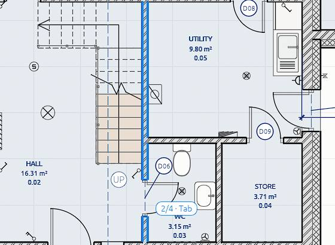
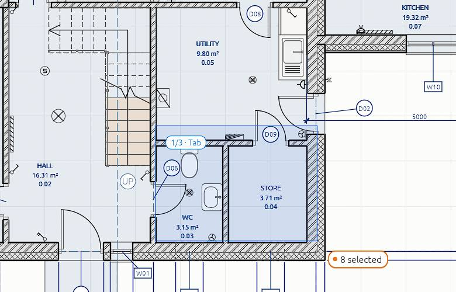

# Selecting

The **Select** tool (the arrow, first in the tool row) is where you are most of the time. With it you pick elements to look at, change, move or delete. Press `Esc` twice in any other tool to come back to it.

## Click to select

- Click an element in any view: 3D, plan, section, elevation, or a view on a sheet. It turns orange in every view, and *Properties* on the right shows its settings.
- `Shift+click` adds an element to the selection, or takes it away again.
- Click on empty space to select nothing. In the 3D view `Esc`, with nothing else to step back from, does the same. `Ctrl+A` selects everything. `Alt+A` also selects nothing, unless another program (a chat app's screen capture, say) has taken those keys for itself: then use `Esc` or *Select › Select nothing*.
- Click a row in the project browser to select that element. `Shift` or `Ctrl` adds to it.

The status bar counts what is selected, and with Select the tool bar ends with the same count, by kind ("5 selected: 2 windows, 2 walls, 1 tag"). With several selected, Delete, Move, Copy and Hide act on all of them, and *Properties* shows the one picked last.

## Hover first

Before you click, the element under the pointer lights up in a quiet blue, in every open view. That is what a click will take.

## Picking what is underneath

Sometimes several elements are under the pointer: a beam inside a wall, a column behind a slab edge. Then a small badge by the pointer counts them, such as **1/3 · Tab**.

- Press `Tab` to move the highlight to the next one, and `Shift+Tab` to go back. The status bar names the one highlighted ("Beam · Lintel beam (2 of 3 under the pointer)"). Click to select it.
- Or click the badge: a short list names every element under the pointer. Hover a row to see which it is, and click it to select it.

A plain click without `Tab` takes what it always took. In an elevation this also reaches what is behind the face you see, such as a slab behind a wall.

For hidden elements you need to work on for a while, [X-ray](visibility#x-ray) (`Alt+Z`) makes walls and slabs faint and puts what is inside them first.

## Select with a box, a circle or a lasso

With the Select tool, the tool bar holds three ways to drag a selection:

| Shape | How |
| --- | --- |
| **Box** (`B` in 3D) | Drag a rectangle |
| **Circle** | Drag from the centre outwards |
| **Lasso** | Draw round what you want, freehand |

- In a plan or section, drag on empty paper.
- In 3D, press `B` (or pick a shape in the tool bar), then drag.

Dragged **left to right** (solid blue), the shape takes only what lies wholly inside it. Dragged **right to left** (dashed green), it takes everything it touches. While you drag, what it will catch lights up, and a small count by the pointer says how many.

Beside the shapes, the tool bar sets what a drag does to the selection: **New** (what you take replaces the selection), **Add**, **Subtract**, **Invert** (what you take flips in or out) or **Intersect** (keep only what is both selected and taken). Held keys do the same for one drag: `Shift` adds, `Ctrl` takes away.

A drag starts anywhere except on something already selected (that drag moves it), in plans, sections and sheets, and in the 3D view with the usual mouse scheme. On a sheet, a box on empty paper picks views, marks and notes.

## The Select menu

The *Select* menu in the tool bar gathers the rest:

- **Select all** (`Ctrl+A`), **Select nothing**, and **Invert**: select what is not selected, and drop what is.
- **Box select**, **Circle select** and **Lasso select**.
- **Select linked**: add what is joined to the selection, such as the walls meeting it and the doors and windows in it.
- **Select random**: keep about half of the selection, picked at random, to thin out a row.
- **All by type**: every wall, every door, every slab… with a count, without selecting one first.
- **Select similar**, as below.

## Select similar

Select one element (or a few), then right-click it, or open the *Edit* menu, and pick **Select similar**:

- **All of this type in the view** (`Shift+A`): every element of the same [type](types) that the view shows. An element with no type goes with those of its kind and sizes (walls of one thickness, windows of one size).
- **All of this type in the project** (`Ctrl+Shift+A`): the same, on every level.
- **All of this category in the view**, or **in the project**: every wall, every door, every slab… as the selection.
- **Similar tags**: with a tag selected, every tag of the same kind (door tags, window tags…) in the same view.
- **Keep only**: with a mixed selection (walls, doors and tags, say), keep only one category of it, such as only the walls. Each entry counts how many there are.

"The view" is the view the menu was opened in: the plan, section or elevation, or the 3D view without what is hidden there.

## Selecting by type or material

- *Select all instances* in *Properties* selects every element of the same [type](types).
- The [material browser](materials) selects every element made of a material.
- Clicking a heading in a schedule grouped by type selects all of its rows.

## The right-click menu

Right-click an element (or empty space) with the Select tool for what can be done right there: move, rotate, copy, delete, hide, flip a wall, *Hide in view*, set the pivot or the workplane. See [Copy, paste, delete and undo](edit).
