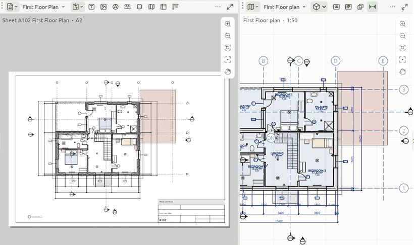

# Sheets and title blocks

A **sheet** is a page for printing, from A0 to A4, with a title block. Views placed on it are drawn from the current model, so they are never out of date.

## Making a sheet

*File › New sheet*, or **New sheet** on the *View* tab. Open a sheet from the browser's *Sheets* group, or in any [area](interface#view-areas) from its view-type menu. The *Sheets* and *Document* [workspaces](interface#workspaces) put a sheet beside the drawing you are placing on it. `PageUp` and `PageDown` step through the sheets.

## The sheet's header

The header of an area showing a sheet holds what belongs to the paper, in groups:

- **Place view…**;
- **Text**, **North arrow**, **Scale bar**, **Revision cloud**, **Revisions table** and **Key plan**;
- **Guides**: the rulers and guides (below);
- the **PDF** of this sheet and **Print preview**: the sheet as it prints, on white.

## Placing views

1. Open the sheet.
2. Click **Place view…** and pick a view: plan, section, elevation, 3D view or schedule.
3. Drag it where it belongs on the paper.

Each placed view (a **viewport**) shows its view at the view's scale, with what the view hides left out.

- **Scale** a viewport: select it and pick a scale in *Properties* (1:1 to 1:500, or type any other after *1:*), or right-click it and choose **Scale**. The viewport grows or shrinks about its middle. The scale is the view's own, so the view shows at that scale on every sheet it is placed on.
- **Crop** a viewport: select it and drag its dashed crop frame's edge handles, or set the crop in *Properties*.
- **Line views up**: while you drag a view, its centre snaps in line with another view's centre, with a dashed guide.
- **Work through it**: double-click a viewport to edit the model right there, with every tool; the rest of the sheet greys out. Drag to orbit a 3D view. `Esc` finishes.

### View titles

Under each viewport is its **title**. In the viewport's *Properties*: show or hide it, its **Number in a circle**, the **Scale under it**, its **Words** (the view's name, or your own), its **Size** and **Text style**. Drag the title on the sheet to place it.

## Selecting and moving on the paper

- Drag a box on empty paper to select views, marks and notes: left to right catches what is inside, right to left what it touches; `Shift` adds.
- **Move** (`M`, or `G` to follow the pointer) moves what is selected on the sheet. It snaps to the paper, the marks, notes, views and guides. Dragging one of several selected items moves them all.
- The zoom column at the area's right zooms, fits and frames the selection.

## Rulers and guides

Turn **Guides** on in the sheet's header: rulers run along the top and left edges.

- Drag a guide out of a ruler; drag it to move it; drag it back onto a ruler to remove it.
- Views (their centre or edges), marks, notes and revision clouds snap to the guides.
- In the sheet's *Properties*: **Copy guides to all sheets**, so a set lines up page after page, or **Clear guides**.

Guides never print. Turned off, they are kept with the sheet.

## Text, north arrow and scale bar

What belongs to the paper, not to a view, goes on the sheet itself:

- **Text** (`N`): click where it starts, then type. It is a [note](notes) on the sheet.
- **North arrow**: turned to the project's true north (*Project information*). Give it an angle of its own in *Properties*.
- **Scale bar**: at the scale of the sheet's views. Set its scale, length, parts and thickness in *Properties*.
- **Picture**: a photo, a render, a logo or a stamp. Pick any number of PNG, JPEG and SVG files at once and they are laid side by side. A picture's pixels are kept in the project; an SVG comes in as crisp vector shapes. Its box grips size it (the corners keep its proportions), and *Properties* has its size, opacity and, for an SVG, one colour.

They are placed clear of the title block. Drag them where they go, or type their **X** and **Y** on the sheet, to the millimetre; `Delete` removes them. Dimensions, tags and notes about the building stay in the views, so they show on every sheet a view is placed on.

## Revisions

- **Revision cloud**: a scalloped outline round what changed, with its revision letter in a triangle (the letter after the project's last). Say what changed and when in *Properties*. Drag its corner and edge grips to size the box, or make it **Freeform**: drag its points, drag a **+** to add one, right-click a point to remove it. **Scallops** sets how long each arc is; it can have its own colour.
- **Revisions table**: a row for each revision cloud on the sheet. Drag it where it goes.

## Key plan

**Key plan** places the lowest floor plan again as a small view of its own at 1:500, over the title block, with its dimensions, tags, notes, grids, section marks and furniture hidden. Drag it where it goes; it is a view in the browser, to change like any other.

## Title blocks and masters

Fill in the title block in the sheet's *Properties*. Project-wide fields (project, client, address, status) come from *Manage › Project information*, and a sheet's own values win over them.

The frame and title block a sheet sits on is its **master**. Pick it in the sheet's *Title block*, or click **Edit the master** to open it in a Masters view, where it is drawn with lines, shapes, text, fields, logos and pictures: what you change shows on every sheet on it. See [Masters: title blocks](masters).

*File › Sheet templates…* is the list of masters: *Copy of the built-in block*, *Import DXF or SVG…* for your own drawing, or another project's masters and styles. Any `{name}` in a master's text becomes a field. `{sheet}`, `{number}`, `{project}`, `{scale}` and `{date}` are filled in by each sheet; other fields get a value per sheet in its *Properties*. Use *Use on this sheet*, *Use on every sheet* or *New sheet from it*.

## Printing and exporting

- `Ctrl+P`, or the PDF button in the sheet's header: the sheet in front, as a PDF named by its number and name.
- `Ctrl+Shift+P`, or *File › Export › Sheets as PDF*: the **Export sheets** window. Choose **All**, **Chosen** (the sheets selected in the project browser, or ticked in the list) or **This one**, and **One PDF** or **A PDF each** (into a folder, each named by number and name). Sheets print on white at their own sizes.
- *File › This view or sheet as SVG* writes the open sheet. See [PDF, SVG and DXF](dxf-svg).
