# Site: terrain, earthworks and hard landscape

The **Site** tools model the ground around the building: the terrain, paved and gravelled areas, and trees and shrubs. Cars and people come from the catalogue.

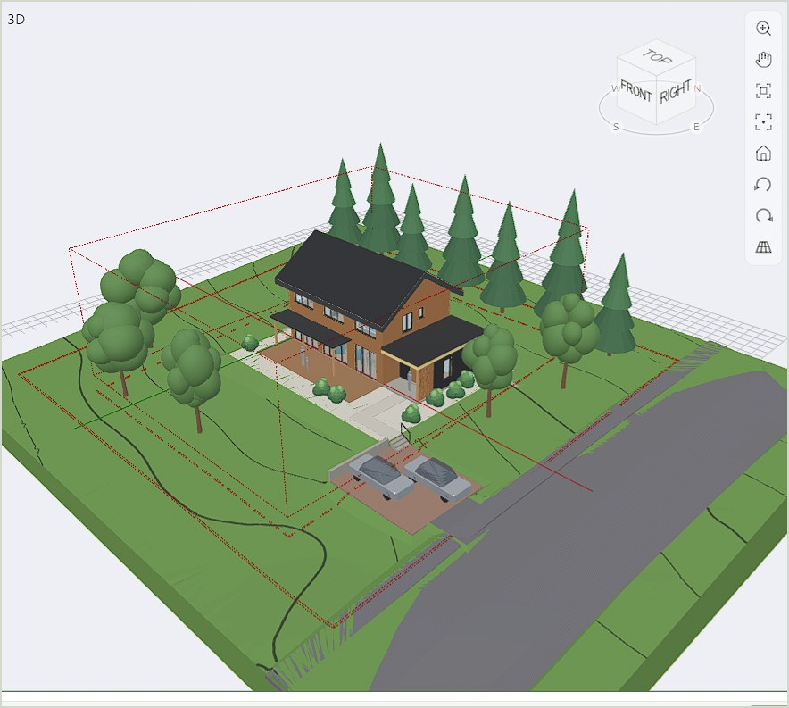

They are one [tool family](interface#tool-families) on the *Model* tab: the **Site** button brings back the last one used, and its arrow opens the Site panel, also under *Create › Site*:

- **Ground**: Ground (a new terrain), Contour line, Spot level, Property line, Investigation point
- **Earthworks**: Pad, Pit, Trench
- **Ways**: Road, Path
- **Hard landscape**: Paving, Driveway, Gravel, Decking, Asphalt, Car park
- **Services**: Drain, Tank
- **Planting**: Tree, Conifer, Palm, Shrub

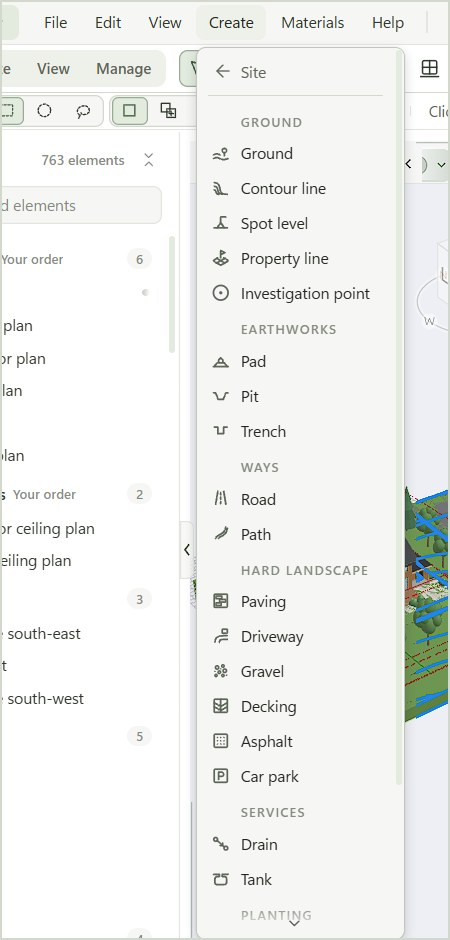

The panel says *what* to make; the tool options strip says *how* (Draw by) and the values (depth, height, width).

## Terrain

1. Pick **Ground** in the Site panel.
2. Set its *Depth* in the tool options.
3. Draw the ground's outline like a slab, with **Draw by**: `1` Polygon, `2` Rectangle, `3` Fill room or `4` From sketch.

New terrain is flat at its level and covered in *Grass* from the material library. It takes its shape from **ground data**: spot heights, contour lines and break lines. The ground passes through every one of them exactly.

### Bringing in a survey

*Import survey* (in the tool options while the Site panel's Ground tools are on, or *Survey › Import…* in a terrain's Properties) reads what a surveyor hands over:

- **A table of points**: Excel (`.xlsx`, `.xls`, `.ods`), `.csv`, `.txt`, or rows pasted straight from a spreadsheet. It needs a column each for easting (X), northing (Y) and height (Z); a column of point numbers and one of codes are understood too. The window shows the first rows and which column it took for what; change them if it guessed wrong.
- **A DXF drawing**: points with a height become spot heights, polylines at one height become contours, 3D polylines become break lines. Pick the layers to bring in. Lines lying at zero carry no height and are left out.
- **Map data**: a LandXML surface (`.xml`: its points, break lines and contours, and survey points), a grid of heights (GeoTIFF `.tif`, Esri ASCII grid `.asc`), GeoJSON (`.geojson`) or a shapefile (`.shp`, with its `.dbf` and `.prj` beside it). They come in by layer, as a DXF does. A line's height comes from its own Z values, or from a column or property named for one (`elevation`, `elev`, `height`, `contour`, `z`, `level`). Lines without a height (boundaries, roads, buildings) are listed and left out. A grid is thinned to about 12,000 points.

You can also drop a table, a height grid, a LandXML file, GeoJSON or a shapefile on the app's window to open it here.

Then set:

- **Units**: what the survey's numbers are in.
- **Codes**: tick the codes surveyed as a line (KERB, TOP, TOE…). Their points are joined in the order surveyed as a **break line**: the ground folds along it instead of rounding over it, so a kerb, a wall or the top of a bank stays crisp. `KERB1` and `KERB2` are two separate strings.
- **Place**: *As surveyed*, or *At the drawing's origin*. A survey in map coordinates is hundreds of kilometres from zero; bringing its middle to the origin keeps drawing exact. What was taken off is kept with the terrain. Once the project is placed on the map there is a third choice, *On the map* (see below).
- **Heights from** (take off heights): a survey's heights are above sea level or a site datum. What you type comes off them, so a site at 312.40 can lie by a ground floor at 0.

#### The project on the map

The first survey you bring to the drawing's origin from map coordinates also **places the project on the map**: the *Project* tab then holds the coordinate system the file named, the easting and northing of the drawing's origin, and the height of the project's zero. You can type or correct them there (*On the map*).

From then on Import survey offers *On the map* and picks it for data in map coordinates: the project's position and height come off the data, so a neighbour's survey, a city height grid or a contour file lands where it belongs beside what is already there.

Longitude and latitude (what GeoJSON is written in, and many height grids) are projected to metres in the UTM zone they fall in. Nothing else is converted: data in one projected system does not land right in a project placed in another, and the window warns when the two names differ. The drawing's up is the map's grid north.

#### Map underlays: boundaries, roads, neighbours and aerial photos

Map data with no heights in it (property lines, kerbs, roads and buildings in a GeoJSON file, a shapefile or an OpenStreetMap export) and aerial photos (a GeoTIFF with its map position) are **underlays**, not ground. Open one the same ways as a survey, drop it on a plan, or click **+ Map** in the *Trace and reference* tab: it becomes a reference under the plan, where it lies on the map.

- **OpenStreetMap**: on openstreetmap.org, *Export* writes the area on screen as a `.osm` file. Buildings, roads, paths, water, land use and property lines come in, each as its own kind.
- **Aerial photos**: a GeoTIFF from a city or national map portal (an *orthophoto*). Its tie point and pixel size place it; one in longitude and latitude is projected to the UTM zone, squared to grid north, which is close enough for a site but not for a whole town.
- **Placing**: the lines follow the project's map position, so correcting the easting or northing in the *Project* tab moves them too. A photo is placed once, where it was when added: drag it or use *Back in place* after a change. The first map underlay places an unplaced project on the map.
- **In 3D** an aerial photo is off at first, because a flat photo at the level would hide the ground and the building; tick *In 3D: Shown* to lay it out. Map lines show in 3D at the level.

Nothing is downloaded: the files come from you, so the app works offline.

With a terrain selected the survey goes into it (*Fit the terrain's outline to the data* redraws its outline round the points); with none selected it makes a new terrain. Points outside a terrain's outline don't shape it, and the status bar says how many there were. Importing is one edit: `Ctrl+Z` takes it back.

### Drawing contours and spot heights

The Site panel's Ground and Earthworks tools:

- **Ground**: a new terrain.
- **Contour line**: for a contour map on paper or a flat drawing. Put the map under the plan as a reference (*trace and reference*), type the **Level** of the line you are about to trace, and click along it; **Enter** or a click on the last point again finishes it, a click on the first closes a ring. The next line is the **Step** higher (type a negative step to work downhill), so a whole map is traced without typing each height.
- **Spot level**: click spot levels onto the terrain, each at the *Level*.
- **Pad**: a levelled platform worked into the ground. Click its corners, then **Enter** (or a click on the first corner again) closes it. Set to *At the ground* it starts at the ground under its first corner, so it changes little until you give it its level in Properties; set to *At a level* it is drawn at the **Level** you type.
- **Pit**: dug the **Depth** below the ground all over. Click its corners; **Enter** or the first corner again closes it.
- **Trench**: dug the **Width** wide and the **Depth** below the ground all along a line. Click along the line; **Enter** or the last point again finishes it.
- **Property line**: a lot's boundary (see *Property and planning* below).

Lines and spot levels go on the selected terrain, or the one under the pointer.

**Where its values are.** Each site thing has an **Element** tab in Properties for what it is and where, and most kinds have a tab of their own beside it for how they are made: **Ground** for a terrain (survey, surface, works, soil layers), **Earthwork** for a pad, a pit or a trench (a trench's width and radius, banks or sides, platform, retaining walls, volumes), **Road**, **Path**, **Drain**, **Tank**, **Property** and **Paving**. How the site is *shown* is each view's, in the **View** tab under *Site*: contours and their interval, heights, shading, water flow, setback lines and bearings. A plan at 1:500 and one at 1:100 can so differ. Whether site levels are written from the datum or from the project's zero is set once, in the **Project** tab (*Site levels*). A line at the foot of the Element tab opens it. Each tab is in folds you can shut, and where a thing has several of something (a road's points, a drain's chambers, a pad's edges, a property's edges, soil layers, easements) they are a list: click a row and its values show under the list. In the Ground tab, *Works* lists every pad, pit and trench lying on the terrain with what it digs and makes up; click one to select it on the plan. In the project browser, *Site ground* lists each terrain with its works, lines and spot levels under it.

**One way to draw.** Every line and outline of the Site tools is drawn the same way: click its points; **Enter** finishes it, and so does a click on the last point again (a line) or the first (an outline). A **right-click** or `Esc` takes back the last point; with none left it leaves the tool.

**Level and Depth.** A *Level* is a height as it is written on drawings; a *Depth* is how far below the ground. A Level is typed in metres, either from the **datum** (100.45, as site drawings write it) or from the **project's zero** (+0.45, as building levels are). *Read from*, under any Level field in Properties, switches between the two (*Datum* or *Zero*) for the whole project; the other reading shows in grey beside the field. Only how it is read changes, never the height itself. The datum is the project's *Elevation* in the Project tab.

**A contour and a spot level you draw are each a thing of their own**, as a pad is: the ground of the terrain they lie on passes through them.

- **Click** one (a spot level's cross, a contour's line) to select it. Its **Level** is in Properties, written as it is on drawings.
- **Drag** it, or use Move and Copy, and the ground follows when you let go.
- **Double-click** a contour to reshape it: drag a point, add or remove points. `Tab` finishes.
- **Delete** removes it and the ground lets go of it.

A survey brought in from a file is different: its thousands of points and lines stay the terrain's own data, counted in the terrain's Properties, and *Clear* removes them all. A project from before this keeps the spot heights and contours drawn in it: they become things of their own when it is opened.

### The terrain's Properties

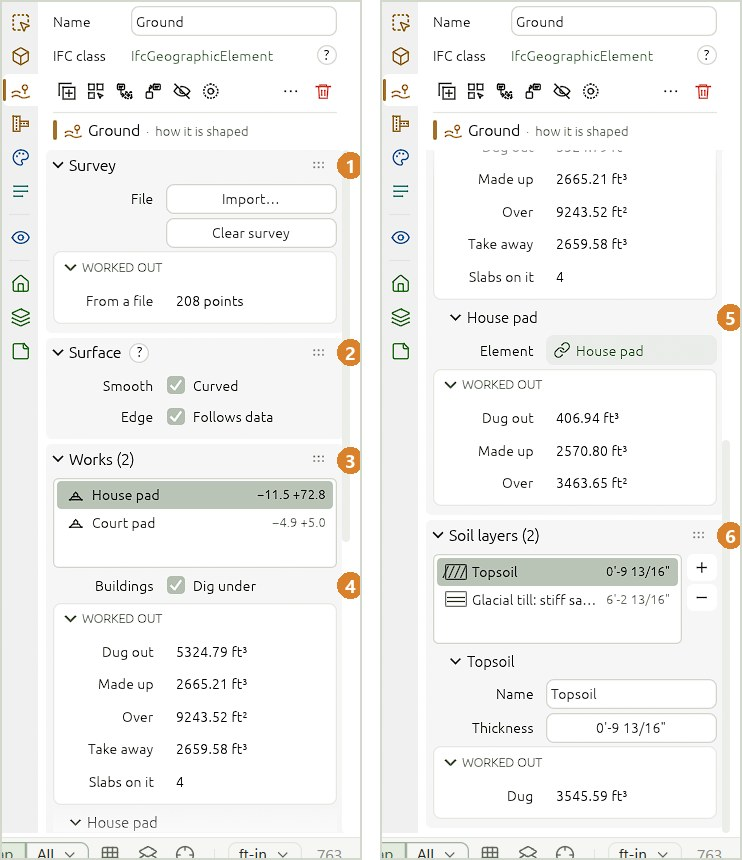

Select the terrain (click the ground) and open its **Ground** tab:

1. **Survey**: *Import…* brings in a survey, *Clear survey* takes it away; *From a file* counts its points.
2. **Surface**: *Smooth* › *Curved* and *Edge* › *Follows data* (see *How the ground is read* below).
3. **Works**: every pad, pit and trench on the terrain, with what each digs (−) and makes up (+).
4. **Buildings** › *Dig under*, then the volumes for the whole terrain: dug out, made up, over what area, what to take away, and how many slabs stand on it.
5. The work picked in the list: a link to select it, and its own volumes.
6. **Soil layers** (below).

### Pads, digging and volumes

A terrain keeps two grounds: the ground **as surveyed** (its spot heights and lines) and the ground **as designed** (the surveyed ground with the site changes worked in). Drawings and 3D show the designed ground; nothing is ever lost from the survey, and removing a change puts the ground back.

**A pad, a pit and a trench are each a thing of their own**, as a road is: worked into the terrain under them, and selected, moved and changed like anything else.

- **Click** one (its outline, or anywhere inside it) to select it. A click on the ground outside it selects the terrain.
- **Drag** it, or use Move, Rotate and Copy, and the ground follows. While you drag, only its outline moves; the ground is worked out when you let go, so a large survey stays quick.
- **Double-click** it to reshape it: drag a corner or an edge, add or remove corners. A trench is reshaped by its line, and its outline follows the line and its width. `Tab` finishes.
- **Delete** removes it and the ground goes back.
- **Properties** has its level or depth, its banks, and what it digs out and makes up on its own.

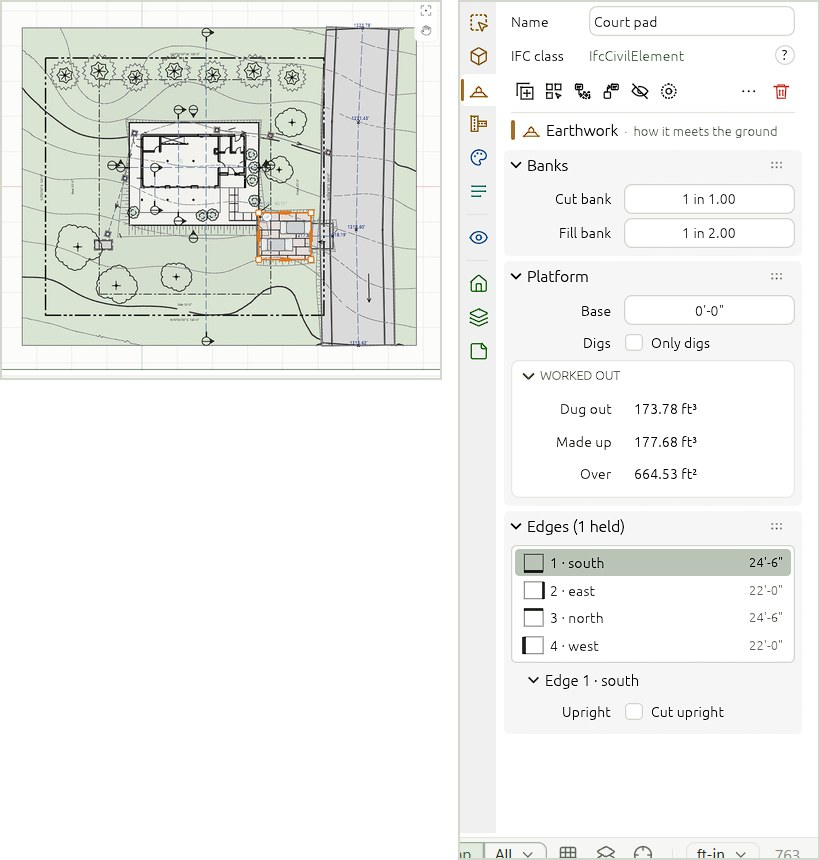
 The terrain's Properties list every work lying on it.

A work drawn off any terrain shapes nothing, and its Properties say so. A project from before this keeps its pads and pits: they become things of their own when it is opened.

- **A pad** levels the ground inside its outline. Where the ground was above it the pad is dug in, with a bank climbing back up to the ground; where it was below, the pad is made up, with a bank falling to it. Each pad has its **Level** (as it is written on drawings) and its two banks in Properties, as *1 in* so many (the run for one unit of height): *dug 1 in 1* and *made up 1 in 2* to start with. **0** is an upright, retained face. Pads are worked in one after another, so a later pad can cut into an earlier one's bank. A pad can have a **Base course**, a layer of that depth laid on it up to its level, and can be set to **Only digs**, which leaves lower ground as it is.
- **A pit or a trench** is dug by its depth, not to a level: its floor follows the ground, so far below it. A trench's sides start upright and a pit's lie back 1 in 2; both are in Properties as *Sides*.
- **Buildings: Dig under** (in the terrain's *Works*) digs the ground out under every slab standing on the terrain, down to its underside, with upright sides. Footings and the walls on them stay buried: their trenches are filled back, so sections draw the ground up against them. Where the ground is already below a slab it is left alone. It is on for a survey brought in with *Import survey*, and follows the slabs as they move.
- **Volumes**: the terrain's Properties say how much is dug out and how much made up in all, over what area, and the difference to take away or bring in. Each work's Properties give its own, measured as if it were alone, so where works overlap they do not add up to the terrain's totals. They are measured between the two grounds as solid earth in place: dug earth bulks up and made-up earth is compacted, which is not allowed for.

**What a pad says about what is built in it.** A pad under the building checks itself against the floor and walls on it, and its Properties say what it finds, with a button to put it right:

- the slab sunk into the pad, how deep the ground is dug under it, and that the stem walls and footings pass through the pad;
- a **crawl space** under a timber floor: how deep it is under the joists, with **Lower it** when it is less than the usual least; where its floor is below the pad, a reminder to keep water out with a drain round the footings;
- a buried floor (the pad lies above the top of the slab), with **Set it below the floor**;
- ground against the timber (the pad lies above the foot of a wall that needs clearance), with **Set it below**.

In plans a pad is drawn with its edge, the line where each bank meets the ground, and the bank hatched from its top with long and short strokes. A section through the works shows the ground as it was as a dashed line over the cut.

### The soils report: boreholes, trial pits and probes

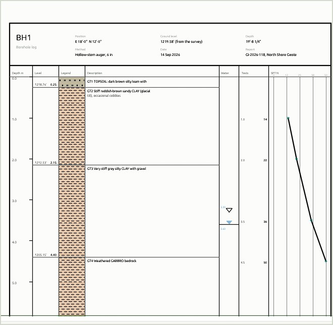

What a soils report found goes in the model where it was found. Pick **Investigation point** in the Site panel's Ground tools and click each borehole, trial pit or probe on the plan. In its *Properties*:

- **Kind**: *Borehole*, *Trial pit* or *Probe*.
- **Ground**: the ground level it reads from the surveyed ground under it, or tick *Report's* to type the level the report gives. With no terrain under it, its ground level is its level's.
- **Depth**, **Method**, **Date** and **Report**: how deep it went, how it was made, when, and the report's reference.
- **Layers**: each layer **Down to** its foot, its **Soil** (*Topsoil*, *Made ground*, *Clay*, *Silt*, *Sand*, *Gravel*, *Peat* or *Rock*), its **Name** across the site (GT1, Stratum B) and its description **As logged**. **Paste from the report** takes the report's rows as they are, one layer a line (its depths, then its description; a code like GT2 first becomes its name), and **Read rows** replaces the layers with them.
- **Water**: where it was **Met at**, and where it **Rose to** after waiting.
- **Tests**: an *SPT N*, *Shear vane*, *Penetrometer* or *Dynamic probe* result at a depth, with the result **As written** when the number alone doesn't say it all.
- **Notes**: anything else the report says.

**Borehole log** opens its log as a view: its layers drawn with their soil symbols and descriptions, its water and its tests, ready to place on a sheet. It follows the borehole as its log changes. A plan's *Investigation* view shows every point on the ground as surveyed.

### Soil layers

Under *Soil layers* in a terrain's Properties, add what the ground is made of from the top down: a name and a thickness each (topsoil, clay, rock). The layers follow the ground as surveyed. A section through the terrain draws the foot of each layer and its name, and the volumes say how much of what is dug comes from each layer, and how much from below the last.

### How the ground is read

- **Smooth** › *Curved* (on by default once a terrain has data): the ground curves through every surveyed height, so contours flow and 3D shows no facets. Off, the ground is the survey's flat triangles between the points, exactly as surveyed. Plans, sections, 3D and volumes always read the same one.
- **Edge** › *Follows data*: on for a survey, the outline's corners take their height from the surveyed heights nearest them. Off, they stay at the terrain's *Top*, so one spot height in the middle of a flat terrain makes a mound.

### Contours in plans

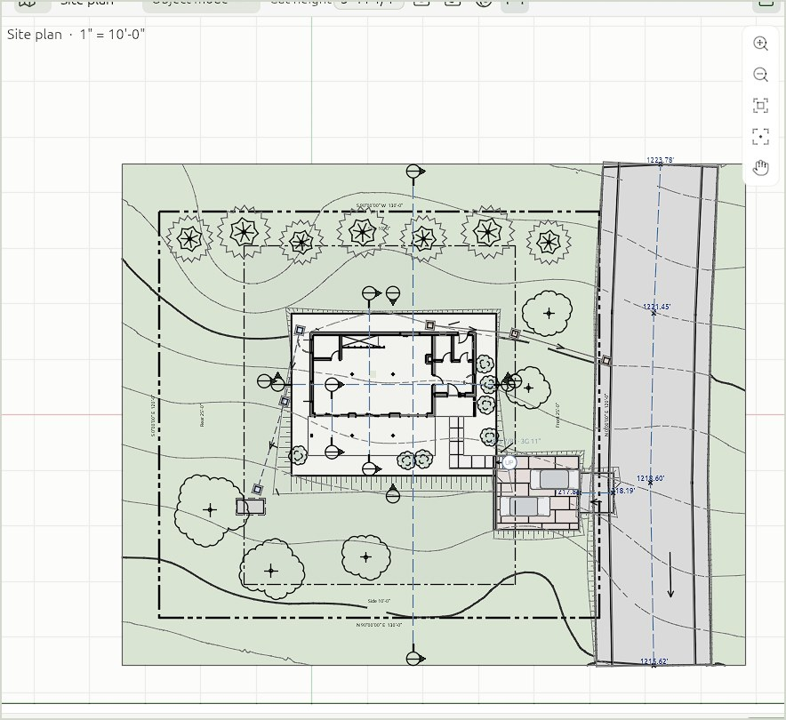

In a plan's **View** tab, under *Site*, set **Interval** to draw contour lines in that view, for example every 250 mm. Every fifth is drawn heavier (**Heavier** changes that), and **Heights: On heavier** writes each one's height on it, the line broken round the number. Each view has its own; a view where you have set none draws as the survey came in, and as an older file had it. The numbers are sized on paper, so they read the same at 1:100 and 1:500. **Spots: Survey's** writes each of a survey's spot heights beside its cross; a spot level you drew always shows its level, in views that show levels. Break lines show dashed.

Sections cut the ground as a solid, hatched as its material is, and 3D shows it smooth or faceted as it is set, with the contours of the first plan that sets its own lying on it in a darker shade of its material, the heavier ones wider. A plan shows the ground whole however high it climbs: the plan's cut does not slice a hill.

### Reading the ground

In a plan's View tab under *Site*, *Shade by* washes the ground in plan with colour:

- **Slope**: flat (under 2%), gentle (2 to 5%), 5 to 10%, 10 to 15%, steep (15 to 25%), 25% to 1 in 3, and over 1 in 3.
- **Aspect**: the way the ground faces, the way it falls, in eight directions from true north (set in the project's map place), and flat where it falls under 1%.
- **Height**: bands of the contour interval (eight bands over its range when there are no contours), from green low to brown high.

The bands are listed below the choice with their colour and how much of the ground is in each, measured in plan. The ground read is the one drawn: with pads, banks and digs worked in.

**Water flow** draws arrows that point the way water runs off the ground, and a circle on each low point where it gathers and would pond. The count of low points is given under the bands.

## Roads, drives and paths

Pick **Road** in the Site panel and set the *Width* (kerb to kerb). Click along the road's middle and click the last point again to finish. Each point starts at the height of the ground under it.

Select the road to set the rest in Properties:

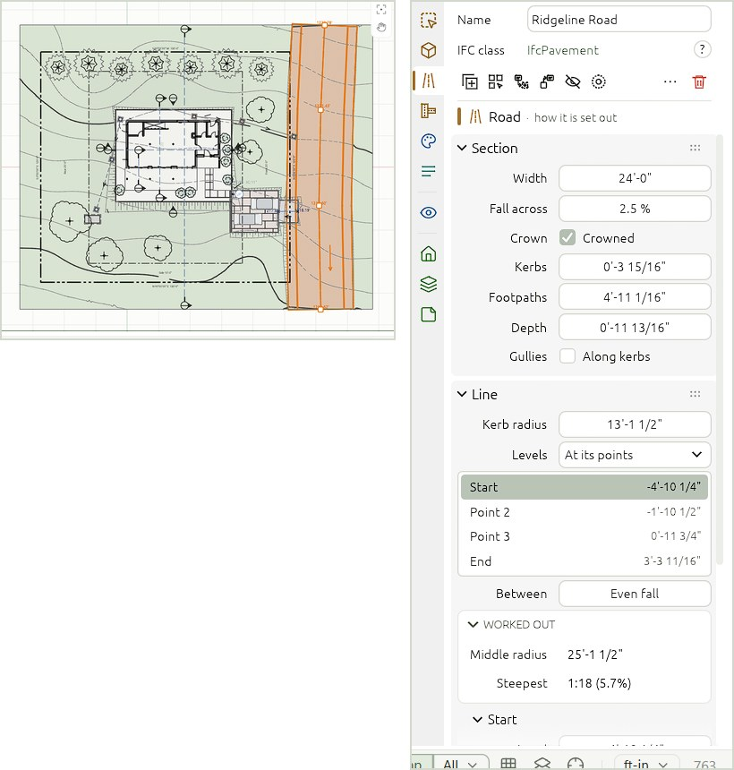

- **Width**, **Fall across** (2.5% is usual) and **Crowned**. A crowned road falls both ways from its middle. Turn Crowned off and it falls one way, to its right looking along it.
- **Kerbs**: how far they stand up. 0 is a shared surface with no kerb.
- **Footpaths**: a path this wide on each side, at the height of the kerb's top.
- **Depth**: how deep its make-up goes under the surface.
- **Levels**: the level of the road's middle at each point. *Even fall* puts the points between the start and the end on one even grade. Under the levels you see its length and its steepest grade, with a note when it is steeper than 1:12 (too steep for a wheelchair) or 1:8 (too steep for most drives).
- **Hold upright** › *Left* or *Right*: that side is cut and made up upright, a retained face, instead of banked.
- **Into the ground** › *Works: Into terrain*: the terrain under the road is dug and made up to its levels, with banks (*Cut bank* and *Fill bank*) out to the ground as it was. The terrain's volumes count it, and its contours stop at the road.
- **Parking**: bays marked down one side or both, each with its width, length and angle (90° square on, 45° or 60° echelon, 0° parallel). They are marked on the carriageway in from its edge, so a car park is a wide road with bays down its sides. The count of bays is shown.

In plan the road shows its kerbs, its footpaths, a dashed centreline, an arrow down each stretch with its grade, and the level at each point. 3D and sections show it as a solid with its kerbs and footpaths. In IFC it is an IfcPavement.

## The site in each view

The *Site* section of a plan view's Properties sets how that view shows the site. Each view keeps its own setting, so one sheet can hold the survey beside the proposed site plan, both live. Nothing is baked into the model.

**Part of: Building or Site.** Anything outdoors that is made with the building's tools (steps down to the garden, a retaining wall, a parked car) can be made part of the site: set *Part of* to **Site** in *Properties*. With several picked, it sets every one that can be. It then shows and hides with the site in every view, and an IFC export places it in the site. *Building*, the usual, shows it with its own category: a stair with the stairs.

- **Ground**:
  - *After the works* shows the ground with pads, digs and roads worked in.
  - *Before the works* shows the ground as surveyed, with no banks and no roads.
  - *After, with the ground as it was* also draws the old contours, light and dashed, wherever the works changed the ground.
- **Contours**, **Levels**, **Banks** and **Roads** switch each kind of site information on or off. Levels covers contour heights, spot levels, and road levels and grades. Under them are how this view draws the ground: **Interval**, **Heavier**, **Heights**, **Spots**, **Shade by** and **Water**.
- **Property lines** switches the property lines, setbacks and easements.
- **Cut and fill colours** washes the ground orange where it is dug and teal where it is made up. The colour gets stronger with depth and is full at 1.5 m.
- **Limit of works** draws a dashed line round everything the works change, where the banks meet the ground.

**Set** is a list of ready-made sets that put every switch at once, for the sheet each trade expects:

- *Survey*: the ground before the works, with levels and the property line.
- *Permit site plan*: the works with the old ground dashed, levels, roads and property lines, and no colours.
- *Earthworks*: cut and fill colours, banks, the limit of works and both grounds.
- *Drainage*: drains, chambers and tanks with their levels on the finished ground, with roads and property lines, and no banks or colours.
- *Investigation*: the ground as surveyed with the soils report's boreholes, trial pits and probes.
- *Everything*: every kind of site information at once.

Change any switch afterwards to adjust the view from there: **Set** then reads *Custom*, and picking a set again puts every switch back.

### Sections, elevations and 3D views

Sections, elevations and 3D views have a *Site* section in Properties too:

- **Ground** works as in plan. *Before the works* cuts the ground as surveyed, with its soil layers whole and no roads. *After the works* cuts it with its works, the ground as it was dashed under the cut. *After, with the ground as it was* draws the old ground grey instead, in elevations too.
- **Level tags** (sections and elevations) mark where the works change the ground: at the edges of each pad, trench and road and the foot and top of each bank. Each tag gives the level after the works in bold, and the level before them light under it.
- **Cut and fill colours** (sections and elevations) wash the ground between the two lines orange where it is dug and teal where it is made up.

The 3D view sets its ground from its eye menu: *Ground: After the works*, *Ground: After, with the ground as it was* (the surveyed ground see-through over the works where they moved it) or *Ground: Before the works*. With both grounds shown, the 3D view's tab in Properties has a slider, *As it was*: slide it down to see the works through the old ground, up to see the ground they replaced.

## Drains and tanks

The Site panel's **Drain** lays a drain run: pick what it carries (*Foul*, *Surface water*, *Combined* or *Drainage field*) in the tool bar, click its head, each chamber down the run, and the last one again to finish. It falls from its head to its end, so draw it in the direction the water runs.

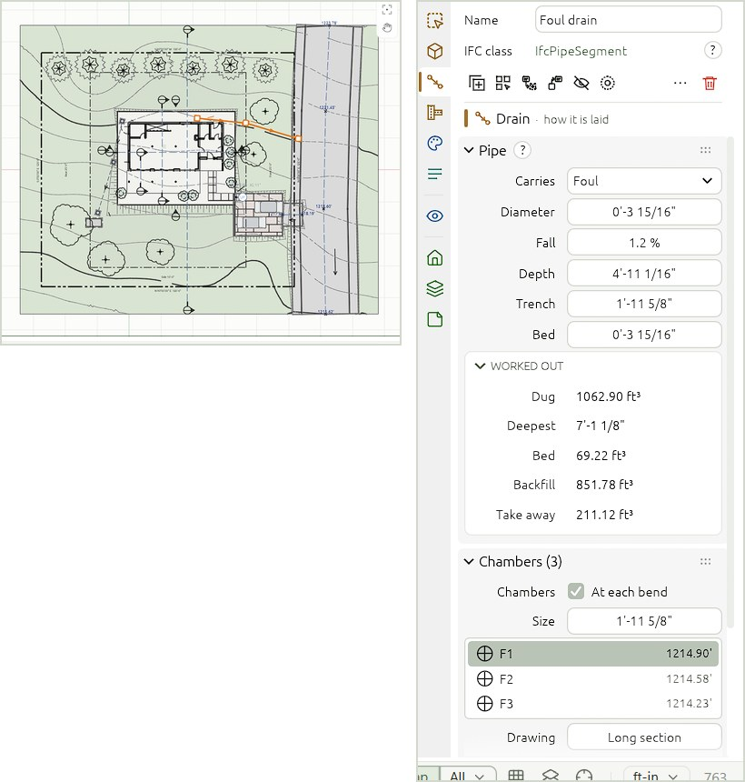

A new drain is a 100 mm pipe at 1 in 80, its invert 600 mm under the ground at its head, with an inspection chamber at its head, each bend and its end. In Properties set:

- **Diameter**: its bore, in millimetres.
- **Fall**: per cent; 1.25% is 1 in 80 and 2.5% is 1 in 40. Hover it to read it as 1 in so many.
- **Depth**: how deep its invert is under the ground at its head. Each invert after it follows from the fall.
- **Trench** (its width) and **Bed**.
- **Chambers**: whether it has them, and their **Size**. They are listed by name with their invert; click one to read its *Cover*, *Invert* and *Depth*.

The ground over each chamber is read from the terrain under it, with its works. Properties lists each chamber's cover level, invert and depth. It warns where the pipe would come out of the ground, or where it has less than 600 mm over it. In plan, each chamber is drawn with its name (F1, F2… or S1… for surface water), its cover level (CL) and its invert (IL). An invert is red where the pipe would come out of the ground. Each length shows its pipe size and gradient, with an arrow the way it flows. Surface water runs are dashed.

**Tank** buries a tank where you click: a *Septic tank*, *Treatment plant*, *Rainwater tank*, *Attenuation tank* or *Soakaway* (pick it in the tool bar). Set its size, depth, turn, the cover over its top, its walls and the working space dug round it in Properties. They give its capacity and its levels.

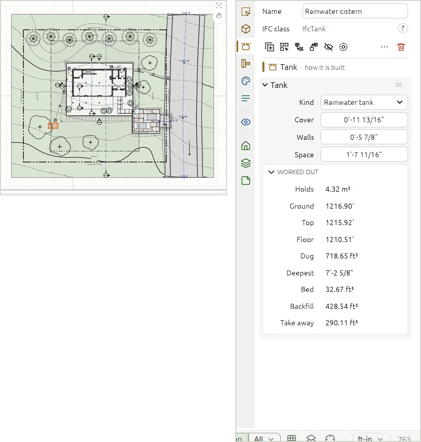

In plan it is dashed, as it is under the ground, with its name, capacity and base level. A soakaway is crossed.

Drains and tanks show in sections and in 3D. Turn on X-ray (Alt+Z) to see them through the ground.

**Dig.** Each drain's or tank's Properties measure what digging it in takes: the volume dug and how deep it goes, what is placed in it, the bed and surround, what is backfilled, and what is left to take away. This is kept apart from the terrain's cut and fill, because the trench or pit is filled back and the ground is left as it was.

A **drainage field** takes treated water from a septic tank or treatment plant into the ground: perforated pipe at 1 in 200, 500 mm deep on 300 mm of gravel, with no chambers. In plan it is drawn with its trench's edges.

**Long section.** A drain's *Long section* button opens its long section: the run unfolded, its heights drawn five times their scale, with the ground over it (the existing ground dashed where the works moved it), the pipe and its chambers, a datum, and a table of each chamber's cover level, invert, depth and chainage and each length's pipe and gradient. It is listed under Sections in the browser and can be placed on a sheet.

**Drainage schedule.** A schedule of the *Drainage* category lists every chamber and tank with its run, cover level, invert, depth and the pipe leaving it, and totals what digging them in takes.

**Road gullies.** Turn on *Gullies* in a road's Properties to give it a channel by each low kerb and a gully every so often (20 m to start, set in *Gully every*). A crowned road has them both sides; one falling one way has them on its right. A gully within 12 m of a surface water or combined chamber shows a dashed connection to it. Gullies are listed in the drainage schedule as G1, G2… with their grating level and the chamber they drain to.

The *Drains and tanks* switch in a plan view's *Site* settings shows or hides them. *Survey* leaves them out.

## Paths

The Site panel's **Path** lays a path on the ground: pick its surface (*Gravel*, *Paving*, *Asphalt* or *Bark*) and its Width in the tool bar, click along its middle, and the last point again to finish. Unlike a road, a path is not worked into the terrain: it follows the ground as the works leave it, and is dug only as deep as its make-up.

In Properties set its surface, width, edging (0 for none) and depth, and **Above level**: how high it runs over its level. They give its length, its area, its edging and the volume dug for its make-up. In plan it is tinted by its surface between its edging: paving is jointed every 600 mm with its courses, gravel is stippled and bark flecked, and its name is written beside it. In 3D it lies on the ground with its edging standing just proud. The *Roads* switch in a view's *Site* settings shows or hides paths too.

## Site levels

Levels on the site (spot heights, contours, chamber and tank levels, level tags in sections, long sections and the drainage schedule) are written in metres above the project's datum, the height of its zero above sea level, to two places: 99.50. In the JSON format the datum is the top-level `datum`. A style pack that gives spot levels a unit of their own is followed instead.

## Property and planning

A **property** is the lot the building stands on: its boundary, what each edge is, and the planning rules it is built to. Draw one with the Site panel's **Property line** like any outline (rectangle, polygon, or picked from a room or sketch), or click **From the map** (the map button beside it) and then inside a lot drawn on a map or a DXF under the plan (*+ Map* or *+ DXF* in *Trace and reference*): its boundary is taken as it is.

In plans the boundary is drawn heavy in long dashes, each edge's **bearing and length** written beside it as on a survey plat (`N 12°30'15" E  24.35 m`, from true north as the *Project* tab sets it). The **setback lines** are dashed inside it, each written with its distance, round a lightly tinted **buildable area**.

In Properties:

- **Edges**: a list of the edges with what each is and how long. Click one for its box: its **Kind**, *Front* (on the street), *Side*, *Rear*, or *No setback* (a party wall), its bearing and length, its **Setback**, and a **Note**. The note is written on the line below the setback in plans; drag it anywhere on the plan, as a note's text, and a thin leader goes back to the setback. *Back in place*, under the note, puts it below the setback again. The first edge drawn starts as the front and, on a four-sided lot, the one opposite as the rear.
- **Rules: setbacks**: the planning rule by kind of edge, *Front*, *Sides* and *Rear*. Every edge of that kind takes it: in its box its Setback reads greyed with *rule* after it. Typing a distance there, or sliding its grip on the plan, gives that edge its own; × puts it back on the rule.
- **Limits**: a **Height** above the project's zero, a **Coverage** (how much of the lot the building may cover seen from above) and a **Floor ratio** (floor area allowed per unit of lot area). A limit of 0 is none.
- **Angle** (daylight planes), also under Limits: from **Starts at** above each edge with a setback, a plane rising inward at the angle set, which the building must stay under. 0° is none.
- In the **View** tab under *Site*, each plan has *Setbacks*, *Bearings* and *Labels: Along the line* (on by default: bearings, lengths and setbacks written parallel to their edge, reading from below or the right; off, level); the Setbacks check runs either way. The 3D view's tab has **Envelope**: the space the rules leave to build in, outlined in blue in 3D: the buildable area from the project's zero up to the height limit, with the angle planes cutting its top. It is only a guide: it never prints and is never exported.
- **Easements**: strips inside the lot along an edge kept clear of building (a storm drain, a sewer, a right of way). **+** beside the list adds one 3 m wide along the rear; click it in the list to set its name, edge and width, and **−** removes it. Plans hatch it and write its name and width.
- **Checks**: the building measured against each rule as you work, green when it keeps to it and red when not, with how many elements reach past the setbacks.
- **Statistics**: the lot, the buildable area, the footprint (everything of the building seen from above, roof overhangs included), the floor area (its slabs, less their holes), the coverage, the floor area ratio, the height and the open space left.
- **From bearings**: type the legs of the deed, one a line, a bearing then a distance (`N 12°30'15" E 24.35`, `S 77 29 45 E 31.20`, or degrees from north like `192.5 18`). The misclosure back to the first corner shows as you type; *Make from these* redraws the boundary from its first corner.

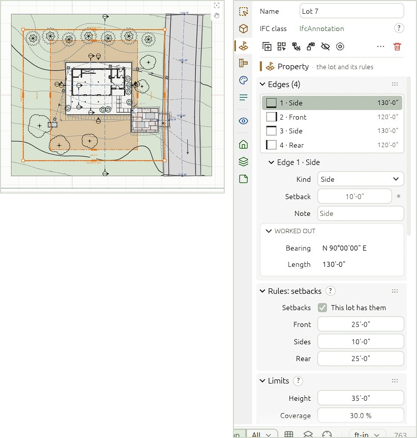

The building is its walls, slabs, columns, beams, roofs, stairs and railings whose middle is on the lot. The boundary's corners can be moved in edit mode (Tab) like a slab's.

## Hard landscape

**Hard landscape** areas are slab-like layers on the ground, each with its own material and surface pattern.

1. In the Site panel, under **Hard landscape**, pick what to draw:
   - **Paving**: 600 × 400 concrete flags.
   - **Driveway**: block paving laid in stretcher bond.
   - **Gravel**: stippled.
   - **Decking**: boards.
   - **Asphalt**: no pattern.
2. Draw the area's outline like a slab, with **Draw by**.

The picks are only starting points. In *Properties*, change the area's *Top*, *Depth* and **Pattern**:

- **Units**: their length, width, staggered courses and angle.
- **Lines**: their spacing and angle.
- **Stipple**: its spacing.

Plans draw the pattern over the area, and 3D shows the area in its material. An area drawn inside flat terrain sits flush: the ground leaves room for it.

## Car parks

A **car park** is hard landscape that lays its own aisles, rows and bays inside its outline, and counts them.

1. In the Site panel, under **Hard landscape**, pick **Car park**, and draw its outline like any area.
2. Draw a **road** up to its edge for its entrance: the bays in the way are left out. Draw a **path** up to it for the door: the accessible bays go nearest that.

Its **Parking** tab, beside *Element*, sets how it is laid out:

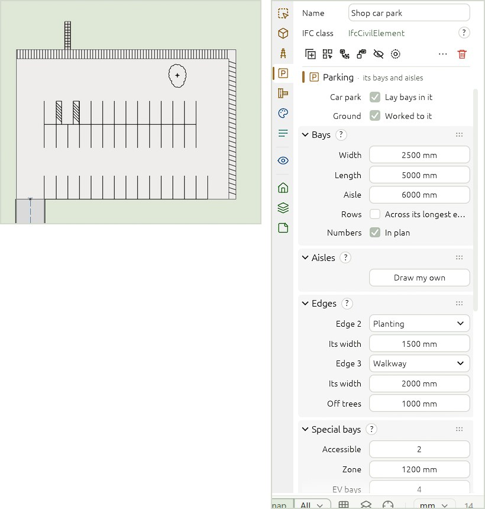

- **Car park: Lay bays in it**: on, it lays and counts its bays; off, it is plain paving. **Ground: Worked to it**: the ground under it is dug or made up to its underside, with banks where it meets the ground round it, so it lies in its own bed on any slope. Off, it sits on the ground as it is.
- **Bays**: a bay's *Width* and *Length*, and the *Aisle* width. Rows run along the car park's longest edge, or across it with **Rows: Across its longest edge**. **Numbers: In plan** writes each bay's number in it, as the schedule lists them.
- **Aisles**: it lays its own; **Draw my own** draws them by hand. Each aisle has its *Width*, **Flow** (*One-way*, with an arrow in plan, or two-way), a kerb radius, a turning head, and its rows on either side: bays *Square on to the aisle*, in *Echelon* at 60° or 45° (easier to drive into, fewer bays) or *Parallel* along the kerb. *Lay its own* takes the hand-drawn aisles away again. **Add an aisle** puts a new straight aisle across the middle (double-click the car park and drag its points to where it goes); **Remove aisle** takes one and its rows away; **Full rows** runs rows you shortened by hand their full length again.
- **Edges**: a strip along any edge, as a *Walkway* or *Planting*, with its width, and the bays' clearance to trees.
- **Special bays**: how many are *Accessible* (in twos, sharing an access zone, nearest the door), *Parent and child* (next nearest), and with an EV charger (at the far end of the row farthest from the door).
- **Required**: how many bays the permit asks for, as a count or per floor area (one bay for every so many m²), and one accessible bay for every so many bays. It shows how many it lays against that.

**One bay at a time.** In Edit mode, drag the end of a row to shorten it. Right-click a bay to **Make it** another kind (*Standard*, *Accessible*, *EV charging*, *Parent and child*, *Motorbike*, *Delivery*), leave it out, or put an island there. A bay keeps what you made it however the car park is laid out again. Its **Bay no.** row says which bay it is, as numbered in plan.

Schedules have a **Parking** category, for a list of the bays.

## Planting

Trees, conifers, palms and shrubs, and the trees CreaBIM grows, have a page of their own: see [Planting and trees](planting).

## Cars and people

*Create › Site › Cars and people…* opens the [Catalogue](furniture) at **Entourage**: a car, a person and a child, for scale. Place them like any other object.

## Reshaping

Terrain and hard landscape areas have the same grips as a slab: drag a corner or an edge, and open them in [Edit mode](edit-mode) (`Enter`) to add or remove corners or change an area's holes. Move plants with the [Move](move) tool (see [Planting and trees](planting)).

## Exchange and visibility

Terrain exports to IFC as *IfcGeographicElement* (TERRAIN), with what is dug and made up as quantities (*CreaBIM_Earthworks*: CutVolume, FillVolume, WorkedArea), and the site carries the project's latitude, longitude and elevation when they are set in the *Project* tab. A project placed on the map also writes where its origin is (*IfcMapConversion* to an *IfcProjectedCRS* named by its EPSG code), which is what other programs use to put the model in the right place; plants as *IfcGeographicElement*, and hard landscape as *IfcCivilElement*. The IFCX format reads them back as the same editable elements. Views can hide them through the *Terrain and hard landscape* and *Planting* categories (see [Visibility](visibility)).
