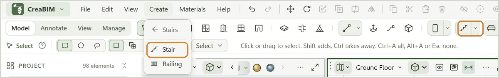
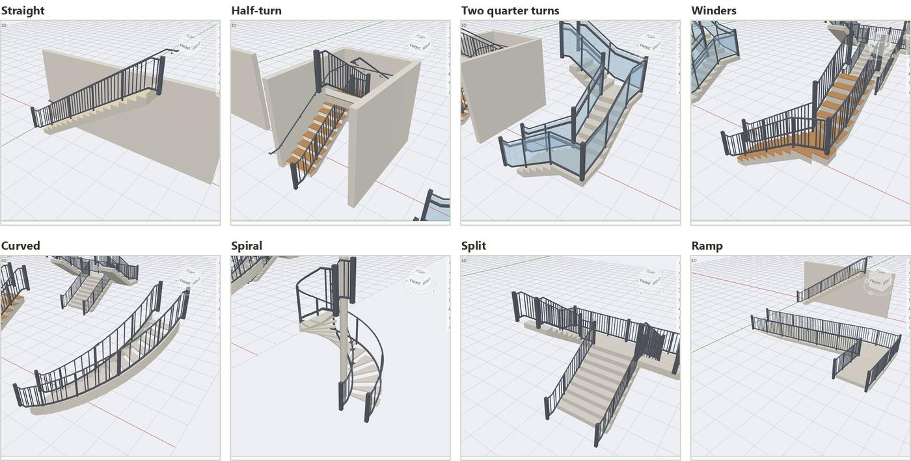
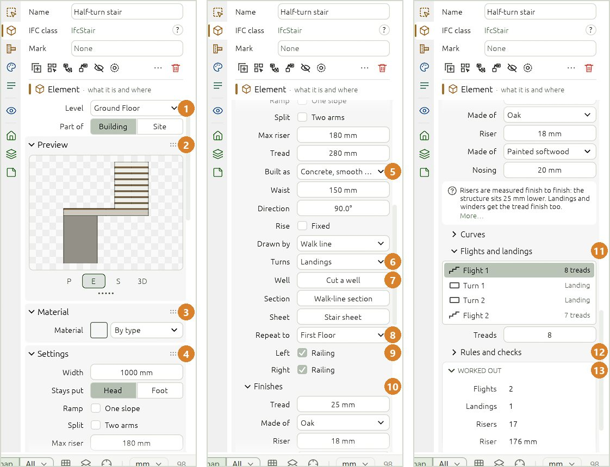
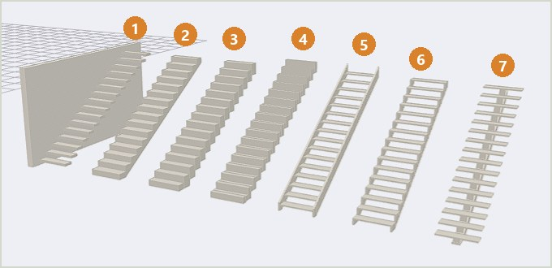
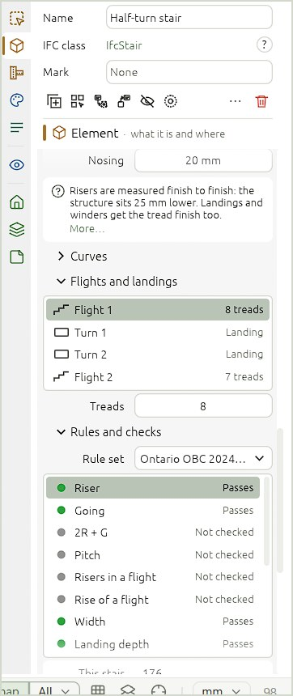
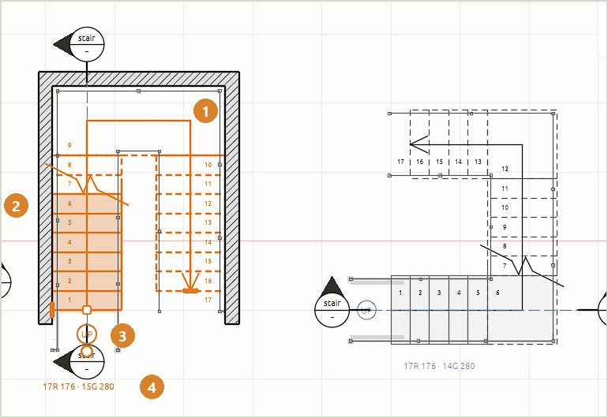

# Stairs and railings

A stair is drawn by its line and climbs to the floor above by itself, in equal risers, with its railings. Every shape below is one stair.

## Stairs

1. Pick the **Stair** tool. In the top bar, pick what you will draw: the **Walk line** up the middle, or the stair's **Left side** or **Right side** (handy along a wall).
2. Click where the stair starts, then click the line it follows. Click again at each turn: a landing goes there. Two turns close together (a U-turn) share one half-landing.
3. While you draw, the pointer shows how many treads are placed and how many are still to go. The stair finishes by itself when the line reaches the floor above. Press **Enter**, or click the last point again, to finish sooner: the last flight runs on past the line. **Esc** cancels.

It rises to the next level in equal risers no higher than *Max riser*. If the line is longer than the stair needs, the extra length deepens the landings before it, and what is left past the last riser is cut off. *Properties* shows the flights, landings, number of risers, their height and the 2R + G comfort rule. Tick *Fixed rise* to type a height instead. *Drawn by* changes which side the line was.

The stair keeps its line: moving or turning the stair takes the line with it.

### Its Properties

1. **Level**, and **Part of** the *Building* or the *Site*.
2. **Preview**: the stair on its own, in plan (*P*), elevation (*E*), section (*S*) or *3D*.
3. **Material**, from its type or its own.
4. **Settings**: **Width**, which end **Stays put** when the treads change (*Head* or *Foot*), **Ramp**, **Split**, **Max riser** and **Tread**.
5. **Built as**: how it is made (below), with its **Waist**.
6. **Turns**: *Landings* or *Winders*.
7. **Well** › *Cut a well*, **Section** › *Walk-line section*, **Sheet** › *Stair sheet* (below).
8. **Repeat to**: the same stair on every floor up to a level (below).
9. **Left** and **Right**: a railing on each side.
10. **Finishes**: tread, riser and nosing (below).
11. **Flights and landings**: each piece, its treads or its depth.
12. **Rules and checks** (below).
13. **Worked out**: flights, landings, risers, riser, rise, going and 2R + G.

### Changing a stair's line

Select the stair and press **Enter** (or double-click it) to open its line:

- drag a point to move it;
- drag a ◇ in the middle of a stretch to add a turn there (a landing goes in);
- click a point (Shift+click for more) and press **Delete** to take a turn away.

The flights and landings fill the line again as it changes, and the railings follow. A line that would cross itself is refused. **Esc** finishes. A stair from an older project has *Make it a line stair* in its *Properties*, which turns its flights and landing into a line to edit the same way.

### Changing one flight or landing

With the line open, press **Shift+Tab** (or choose *Pieces* under *Grips* in *Properties*) to see the stair's pieces:

- a grip on each flight's top riser: drag it back for fewer treads, on for more. The flights after it take the rest;
- a grip in each landing: drag it back down the flight that climbs to it to make it deeper. That flight stops sooner.

The last flight has no grip, because it always takes what is left. Each change is kept with its flight or landing, so it stays when you drag the line again or add a turn. A flight with more treads than its straight has room for gets as many as fit. Right-click a grip to reset that piece, or all of them. **Shift+Tab** goes back to the line.

*Properties* lists the same thing under **Flights and landings**: each flight's treads (*Fit to the line* lets it take as many as fit before the turn again) and how much deeper each landing is.

Where a flight meets a landing, the flight's underside runs on until it meets the landing's, so the soffit has no notch. The landing is as thick as the flight's waist measured straight down.

### Winders

A turn can climb on **winders** (tapered treads) instead of a landing:

- for every turn of a new stair: tick **Winders** in the Stair tool's bar;
- for every turn of a stair: *Turns: Winders* in its *Properties*;
- for one turn: *Turn 1, 2…* under *Flights and landings*, where you can also set how many winders it has.

A turn gets one winder for each 30° it turns, so 3 at a quarter turn, as the National Building Code of Canada allows in a dwelling (9.8.4.5), plus one for each going of line left over before it. The winders for the turn fan out from the inside corner at equal angles. Each extra one is a square tread before the turn, sharing that length; length too short for one goes to the first winder. Each winder is a riser higher than the one before, so the walk line, the railings and the underside (stepped, a riser at a time) climb round the corner. A half-turn on winders turns twice, one set at each corner.

### Curved and spiral stairs

Any straight of a stair's line can bend into an arc, and the flight on it curves with it, each riser square to the walk line (so radial round the arc) and each tread keeping its going on the walk line:

- in Edit mode (Enter), right-click a straight's middle and choose **Make arc**: it bends a quarter turn the way the line turns next; **Straighten** takes the bend away;
- under **Curves** in its *Properties*, set how far each straight bends, in degrees, to the left when positive (up to 180° each).

A gentle bend keeps one flight going round it; where the line turns sharply between a straight and an arc there is a landing (or winders), as at any other turn.

For a **spiral stair**, tick **Spiral** in the Stair tool's bar, click its centre, then where it starts (on the line you draw it by: its walk line, or a side). It climbs anticlockwise round arcs of half a turn or less until it reaches the floor above. A stair round a centre whose inside edge is closer to it than the stair is wide exports to IFC as `SPIRAL_STAIR`; other curved stairs as `CURVED_RUN_STAIR`.

Railings follow the curve with their posts evenly spaced along it. A concrete stair's underside runs round the curve as a smooth helix.

### How a stair is built

Choose **Built as** in the stair's *Properties*:

| | Built as | What you get |
| --- | --- | --- |
| 1 | Cantilevered treads | 80 mm treads with nothing under them, as if built into the wall beside them. |
| 2 | Concrete, smooth underside | A waist slab under the steps, its underside one straight slope (a helix round a curve) meeting each landing flush. The default. |
| 3 | Concrete, stepped underside | Each step a block one riser and a waist deep, so the underside steps up with the treads. |
| 4 | Folded plate | Treads and risers as plates of one thickness (*Plate*), as in folded steel. Landings and winders are plates too. |
| 5 | Side stringers | 40 mm tread boards between two 50 × 280 mm boards along the sides, their tops a little over the nosings. Open risers. |
| 6 | Cut stringers | Tread boards on two stringers cut to the steps under each side. |
| 7 | Central spine | Tread boards on one 200 × 250 mm beam under the walk line, with a bracket under each tread. |
| | Spiral post | Tread boards round a Ø 200 mm post at the centre of a curved stair, up to handrail height over the floor above. Without a curve it falls back to a central spine. |

*Waist* (or *Plate*) is the concrete or plate thickness; open builds don't use it. Sections cut each build as it is: the solid concrete filled, open builds as their boards and members. In the JSON model a stair's `build` is one of `concrete` (left out), `stepped`, `folded_plate`, `stringers`, `cut_stringers`, `spine`, `cantilever` and `post`.

### Finishes

Under **Finishes** in a stair's *Properties*:

- **Tread** and its **Made of**: a finish on every tread, landing and winder, such as 25 mm oak.
- **Riser** and its **Made of**: a finish on each riser's face. A stair with open risers (stringers, spine, cantilevered, spiral post) has none.
- **Nosing**: how far each tread's finish runs out past the riser below it.

Risers are measured finish to finish. The finished treads are a riser apart, and the structure sits the tread finish lower, so the stair's bottom bears on the floor's structure under its finish.

Each finish shows in 3D in its material's colour, and in sections as its own layer, hatched in its material's hatch. The [take-off](take-off) lists a stair's structure, estimated by how it is built, and each finish as a line of its own, measured by area.

In the JSON model a stair's `finish` holds `tread`, `tread_material`, `riser`, `riser_material` and `nosing`.

Stairs from older projects keep their **L-shaped** switch: set after how many risers the landing comes (**Landing after**) and which way the stair turns.

In plan, a stair is drawn with its risers below the cut, a break line, the treads above the cut dashed, and a walking line with an arrow and *UP*. On the level it climbs to, the whole stair is drawn where its well lets you see it, with *DN*; the plan's *View depth* sets how far down it looks (see [Views](views#plan-graphics)).

> **Note:** A stair doesn't cut the slab above by itself. Draw a [shaft](holes#shafts) for its stair well.

### Rules and checks

Each stair is checked against a rule set, live, under **Rules and checks** in its *Properties*. Pick one in **Rule set**:

- *Comfortable house stair (no code)*
- *Ontario OBC 2024, dwelling* (the default)
- *US IRC, dwelling*
- *UK Part K, private stair*
- any of the project's own

Each check shows a dot: green passes, red fails, grey isn't in that rule set. The list covers the riser and going, 2R + G, pitch, risers and rise in a flight, width, landing depth, winders (their turn, their going in from the inside edge and their narrow end), a spiral's own riser and going, the nosing, whether it reaches the floor, and its railings: handrails on both sides, their height, the guard's height, its openings and the rail's grip.

Open **Rule set values** to change a limit: the riser, the going and the width, the headroom, the nosing, the winders' going and narrow end, and the handrail's height (**Rail at least** and **Rail at most**, above the pitch line). Changing a preset's value saves a copy as one of the project's own rule sets ("…, edited"), and the stair is then checked against it.

**Check stairs** on the *Manage* tab selects every stair that fails a check and lists what fails.

### Headroom and stair wells

**Headroom** in the checks is the least clear height over the stair, measured from the line through the nosings to the underside of any slab, beam or roof above, along the walk line and both sides. Where it is short, a red see-through box shows that stretch in the 3D view.

**Cut a well** cuts an opening, called "Stair well", in the floor above: from where the floor would come lower than the headroom, to the top of the stair, as wide as the stair. The well belongs to the stair. It is cut again when the stair or the floor changes, and it is deleted with the stair. **Well clearance** starts it further down the stair. To keep a well of your own shape, draw it with the Shaft tool instead.

**Walk-line section**, under the checks, opens the stair unrolled along its walk line: every flight, landing and winder at its true going and rise, the pitch line through the nosings, the floors cut, the dashed headroom line and, washed red, any floor that comes inside it. The least headroom is measured where the check finds it. The section follows the stair as it changes, is deleted with it, and is listed under Sections in the project.

### Drawing a stair

A plan at 1:100 or larger numbers each riser on the tread it lifts you to, counting from the bottom; a winder's number sits in its middle. **UP** marks the foot of the walk line, **DN** the head on the floor above, and the tag under the stair gives its risers and goings. Select the stair in a plan and the UP label has a grip of its own: drag the label off whatever it covers and its arrow stays; drag it back by its place and it goes home.

The **Stair schedule** (New schedule › Stairs) lists every stair: its risers and goings, 2R + G, pitch, width, least headroom, rule set and, under **Checks**, Passes or the checks it fails.

**Stair sheet**, under the walk-line section, makes a sheet for the stair: the plans of the floor it starts on and the floor it reaches at 1:50, cropped round it, its walk-line section, a 3D view cut out round it, and the stair schedule. Each is an ordinary view, so it stays live and can be moved, cropped or taken off the sheet. The sheet is the smallest of A2, A1 and A0 they fit on.

The plans and the 3D view keep following the stair: move it or make it wider and their crops go with it. To fix a crop where it is, switch off **Crop follows** in the viewport's Properties, or drag a crop handle.

Checks advise; they don't certify. The values come from notes on each code: check them against the edition you work to.

### Split stairs

A split stair is one wide flight up to a landing, then two arms. Tick **Split** in the Stair tool's bar, or in the Properties of a stair whose line turns, and draw one arm: up the middle, across the landing, back down one side. Its mirror image comes with it, across the shared flight's edge on the side away from the turn. The shared flight is twice the stair's width, with no line, rail or riser numbers down its middle. Railings run up both arms, and **Cut a well** cuts one well over both. It is still one stair, with one row in the schedule and one IfcStair, of type DOUBLE_RETURN_STAIR.

### Stacked stairs

**Repeat to**, at the end of a stair's Properties, repeats it on every floor up to the level you pick: the last copy arrives there. Each floor's stair is a stair of its own, named after its floor, but the stack stays one design: change any of them, or a railing on any of them, and every storey changes. **Cut a well** on one cuts a well on every floor that needs one.

Pick a lower level to make the stack shorter, or the level just above the stair for this floor only. **Release this storey**, on a copy, takes it out of the stack as it stands, to change on its own; repeating again leaves it alone. If the stair at the foot is deleted, the lowest copy takes its place.

### Ramps

Tick **Ramp** in the Stair tool's bar, or switch on **Ramp** in a stair's Properties, for one smooth slope instead of steps. A ramp is drawn and changed like a stair: by its walk line or a side, with curves, railings and its own walk-line section and sheet. Every turn is a landing.

Its Properties give the **Slope** as 1 in so many (1:12 to start) and the slab's **Thickness**, square to the slope. Under Flights and landings, each flight is set by its length. The tag in plan reads **Ramp 1:12 · 8.3%**.

The checks for a ramp are its slope, the rise of each flight between landings, its width and its landings' length, with handrails on both sides. A long straight ramp gets no landing partway along: put a turn in its line, or draw two ramps. A ramp goes out to IFC as an IfcRamp.

## Railings

A new stair gets a railing on each side whose box is ticked in the Stair tool's top bar (**Left railing**, **Right railing**). Afterwards, tick or untick *Left railing* and *Right railing* in the stair's *Properties* to add or take off either one. Each railing is:

- Where a wall runs beside the stair, a **wall handrail** on brackets, set 50 mm off the wall, returning to the wall at each end.
- On an open side, a **guard** with posts.

Both follow the walk line moved out to their side, so the rail stays continuous round every turn: tight round the inside of a U-turn, round the landing on the outside. Over winders the inside rail climbs steeply round the corner. When a guard has newel posts, the rail stops at one newel at the corner and starts again higher on its other side. Round a curve or a spiral's column the rail climbs steadily, so it runs on unbroken. Each runs on past the ends: 300 mm level at the top, and one tread's going on the slope plus 300 mm level at the bottom. Change the *Kind*, or the lengths past each end, in the railing's *Properties*.

- Pick the **Railing** tool and click inside a stair: each side without a railing gets one, following the flights and landings.
- Or click the points of a path and click the last point again to finish.

Railings on a stair belong to it: they move with it and are deleted with it.

A railing's **Top rail** in *Properties* can take a profile from the [library](profiles), such as the *Handrail* preset or one of your own.

### Guards

A guard's *Properties* set how it is filled and how tall it is:

- **Infill:** *Bottom rail* (a rail 100 mm above the steps), *Balusters* (20 mm bars, close enough that a 100 mm sphere can't pass) or *Glass* (12 mm panels between the posts).
- **Guard** › *Taller*: the guard rises to *Guard height* (1070 mm by default), with the handrail kept at its own height on the inside.
- **Newels** › *Posts*: 90 mm posts at the ends, at each corner, and one where a short steep piece breaks the rail (the inside of a landing or of winders).

A new guard on a stair gets balusters and newels.

### Grip

Under *Top rail* a note says whether a hand can hold the rail. A round rail must be 30 to 43 mm across; any other shape must be 100 to 125 mm round and no more than 45 mm across (NBC 9.8.7.5). The default 50 mm square bar fails, so pick a handrail profile where people hold the rail.
