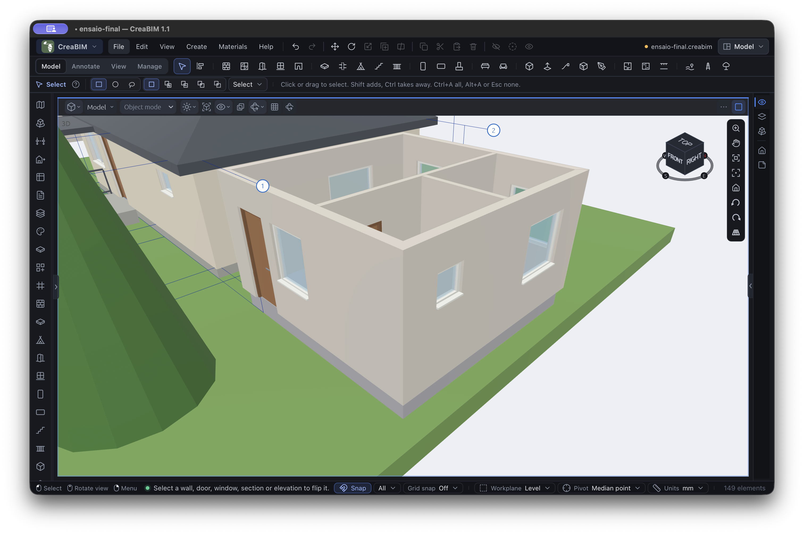
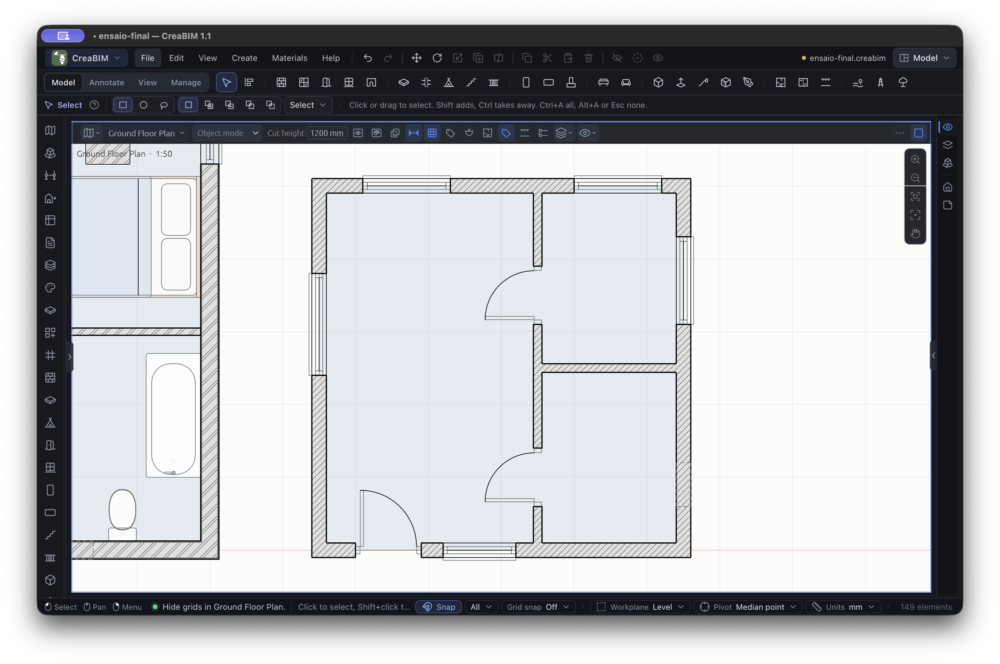

# MCP prototype: a live modelling experiment

This is an AI-assisted prototype in a fork, for discussion before a potential contribution. It adds an optional, authenticated local bridge to the CreaBIM desktop app and a Python MCP server. It can inspect the active document and create levels, walls, slabs, hosted doors and windows, rectangular columns and beams. It can also move certain elements, delete supported elements without dependents, and undo. See [setup, tools and limitations](../../../tools/mcp/README.md).

The screenshots show a small 5 × 5 m house added by the MCP to the example project while CreaBIM was open. The model has a slab, six walls, three doors and six windows; it has no roof or furnishings. The original example house remains beside it. [Download the CreaBIM project](example-house.creabim).

The prototype runs locally and is disabled by default. It does not control an unmodified release, does not save automatically, and is not a full BIMCraft equivalent. Test on a copy of a project; save before switching documents. This experiment was tested on macOS with Apple Silicon; other platforms have not been verified.
